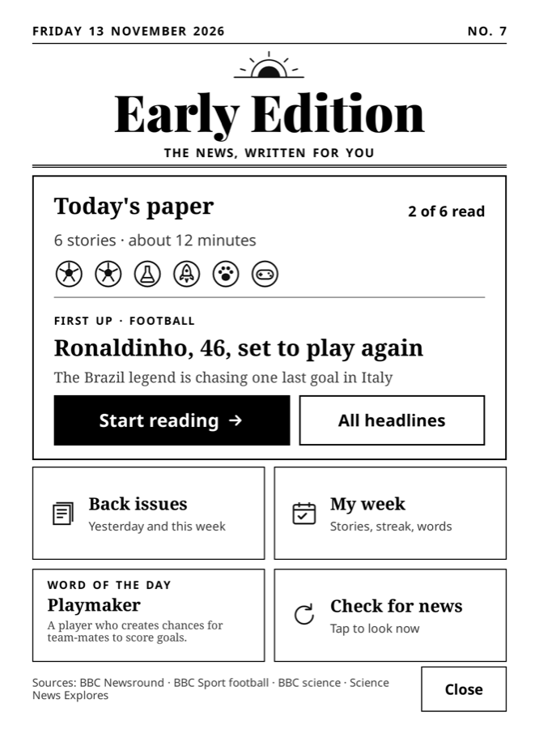
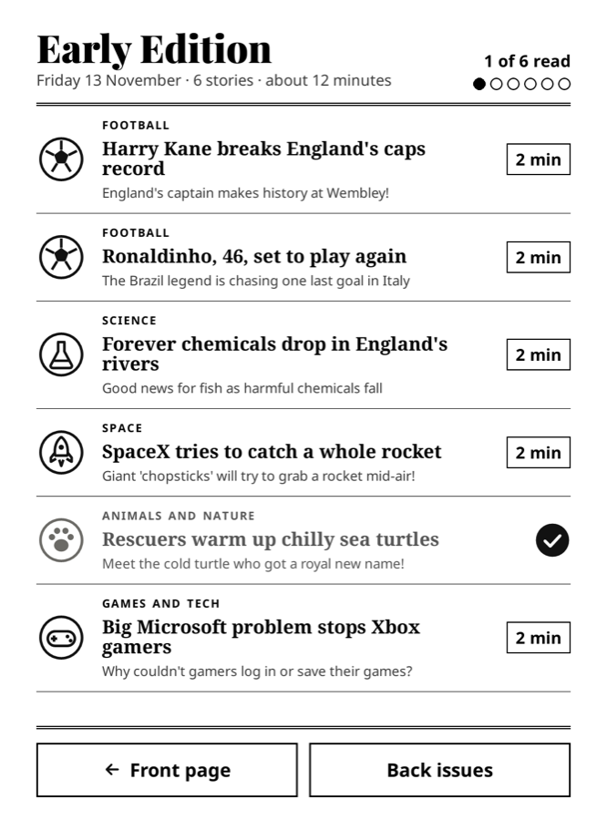
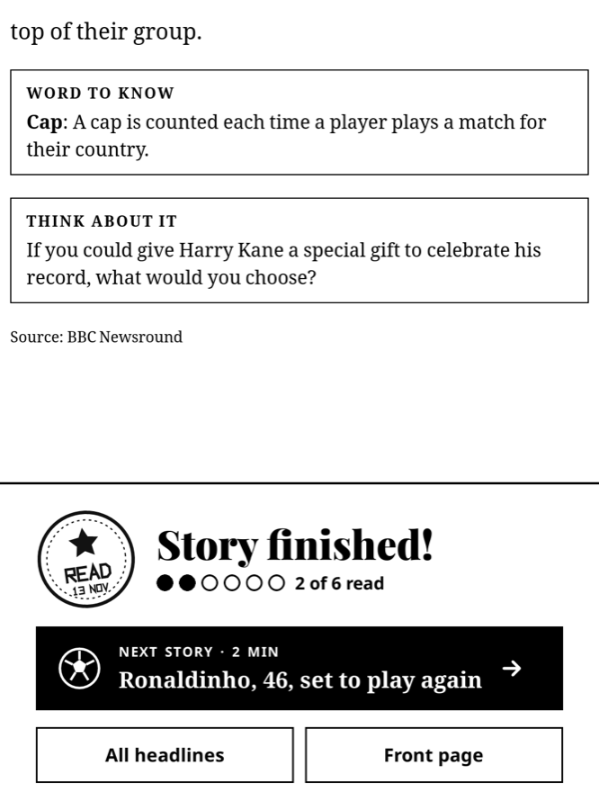
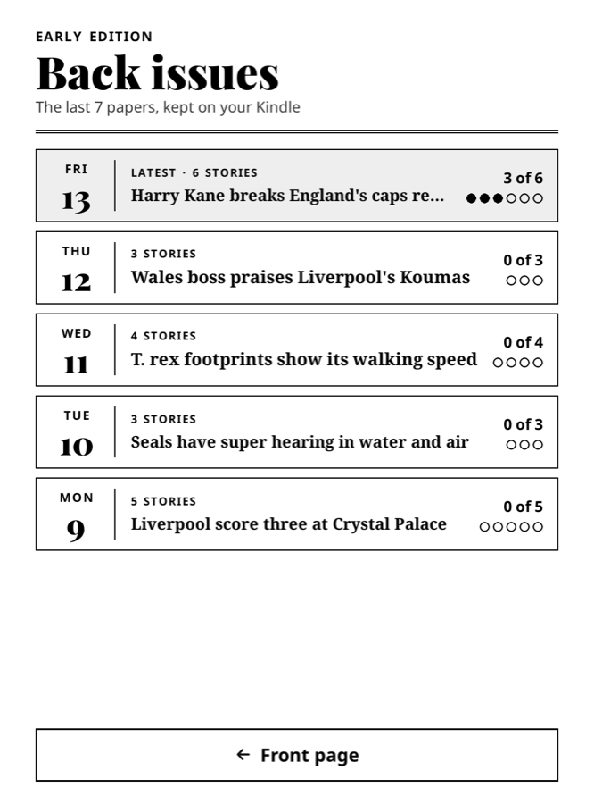
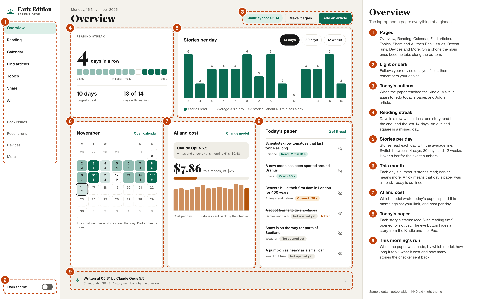
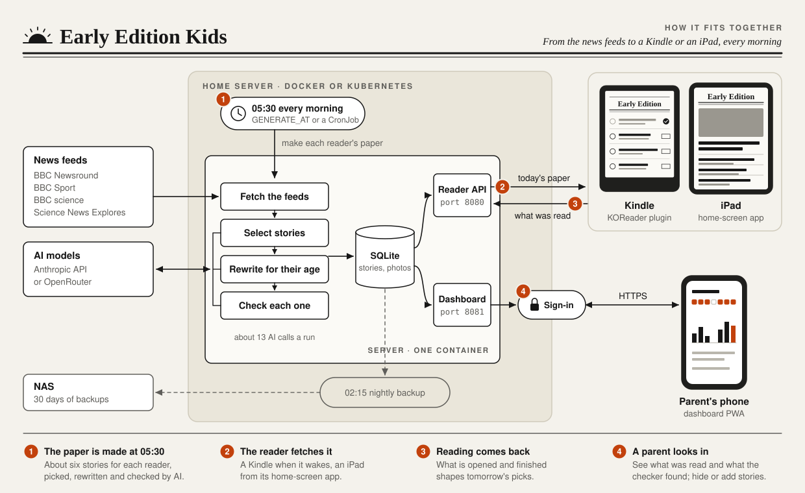

# Early Edition Kids

> [!IMPORTANT]
> ## 🤖 This is an AI-assisted project
>
> **Most of the code, docs and diagrams in this repo were written by AI.** The design came out of a chat with Claude on claude.ai, and the server, KOReader plugin, parent dashboard, tests and docs were then built with Claude Code (Anthropic's coding agent). A person directed the work, made the decisions, and tested it on a real Kindle and a home k3s cluster.
>
> It runs every morning for one family. Read the code before you rely on it, and treat it as a starting point rather than a finished product.
>
> The daily stories themselves are also written by an AI model, and checked by a second AI call before they reach the Kindle. See [the model comparison](docs/model-comparison.md) for how well that works.

Early Edition Kids is a daily news brief for a child's jailbroken Kindle: a small server picks about six stories each morning from kids' and UK news feeds, rewrites them at an 8 year old's reading level with an LLM, and checks them for safety. A KOReader plugin downloads the issue when the Kindle is woken, shows a headline list, and reports what was read so a parent can see it and tomorrow's selection can follow it.

See it in action on [the project's website](https://kris-g.github.io/early-edition-kids/), with a short film of the paper on an iPad.

| Front page | Today's paper | End of a story | Back issues |
|:---:|:---:|:---:|:---:|
|  |  |  |  |



More in the docs: [the Kindle screens](docs/kindle.md), [reading on an iPad](docs/ipad.md), [the parent dashboard](docs/dashboard.md), [architecture diagrams](docs/architecture.md) and [the model comparison](docs/model-comparison.md).

## How it fits together

<picture>
  <source media="(prefers-color-scheme: dark)" srcset="docs/images/architecture/system-dark.svg">
  
</picture>

## Layout

| Path | What it is |
|---|---|
| `server/` | Node.js + TypeScript (Express) server: feeds, selection, rewriting, checking, SQLite, the Kindle API and the dashboard API. `server/Dockerfile` builds the image from the repo root and includes the built `web/` and `reader/` apps. |
| `web/` | The parent dashboard: a React PWA served by the server at `/dashboard/`. |
| `reader/` | The child's iPad reader: a home-screen web app served on the Kindle port at `/read/`. |
| `plugin/` | `earlyeditionkids.koplugin`, the KOReader plugin for the Kindle. |
| `deploy/` | Example Kubernetes manifests (`deploy/k8s/`) and a local multi-arch build script. |
| `site/` | The [promo site](https://kris-g.github.io/early-edition-kids/): plain HTML, published to GitHub Pages by `.github/workflows/site.yml`. |
| `.github/workflows/image.yml` | Builds the multi-arch image and publishes it to `ghcr.io/kris-g/early-edition-kids`. |
| `.gitlab-ci.yml` | The same build for the author's private GitLab mirror. |
| `docs/` | Tours with screenshots, architecture diagrams and the model comparison. Start at [`docs/README.md`](docs/README.md). |
| [`docs/DESIGN.md`](docs/DESIGN.md) | The spec. |
| [`docs/CONTRACT.md`](docs/CONTRACT.md) | The exact interfaces shared by server, plugin and deploy. |
| `reports/` | Raw results of the model comparison runs. |

## Getting started

You need:

- **A computer that stays on,** with Docker: a home server, a NAS or a Raspberry Pi 4 or 5. The image runs on amd64 and arm64.
- **An LLM key:** an [Anthropic API key](https://console.anthropic.com/), an [OpenRouter](https://openrouter.ai/) key, or both. With Claude Opus writing and checking, a paper costs about $0.35, so about $10 a month. Cheaper models can be chosen on the dashboard.
- **A jailbroken Kindle running [KOReader](https://koreader.rocks/),** on the same network as the server.

### 1. Run the server

```bash
docker run -d --name early-edition-kids --restart unless-stopped \
  -p 8080:8080 -p 8081:8081 \
  -v early-edition-kids:/data \
  -e LLM_API_KEY=sk-ant-... \
  -e GENERATE_AT=05:30 \
  -e DASHBOARD_PASSWORD=choose-a-long-password \
  ghcr.io/kris-g/early-edition-kids:latest
```

- **`GENERATE_AT`** makes the paper every morning at that time, London time. If the server starts later in the day and there's no paper yet, it makes one straight away.
- **Port 8080** is for the Kindle and the iPad reader, so it's open to your network.
- **Port 8081** is the parent dashboard, at <http://localhost:8081/dashboard/> or the same port on the computer's address from your phone. **`DASHBOARD_PASSWORD`** makes it ask for that password and keeps you signed in for 30 days (add `-e DASHBOARD_USER=...` to ask for a user name too). It is plain HTTP, so keep it on your home network, or put an HTTPS proxy in front to use it from outside. Without `DASHBOARD_PASSWORD` the dashboard has no login at all: then use `-p 127.0.0.1:8081:8081` so it only opens on the computer itself, or put it behind a proxy that asks for a login, such as Authelia or Tailscale.
- **Data** (issues, reading history, settings) lives in the `early-edition-kids` Docker volume.
- **OpenRouter:** use `-e OPENROUTER_API_KEY=...` instead of, or as well as, `LLM_API_KEY`.
- **To try it with no key at all,** use `-e LLM_BASE_URL=stub` instead of `LLM_API_KEY`. The stories are placeholder text under the real headlines.

`docker logs early-edition-kids` should then show a line like `schedule: issue for 2026-11-16: created`.

**Make it your child's paper.** The built-in settings are an example, for an 8-year-old football fan in the UK. Copy [`server/config.example.yaml`](server/config.example.yaml), change the age, topics, favourite team and players, and feeds, then run the command again with `-v "$PWD/config.yaml:/config/config.yaml:ro"` added. Everything runs on London time and the feeds are British, so it suits a UK reader best. [Settings](docs/settings.md) explains each setting in the file.

**More than one child?** Add a `profiles:` list to the config (there is a commented-out example at the end of `config.example.yaml`). Each child gets their own paper, reading history and dashboard; anything not set in a profile comes from the rest of the file. List the child who already uses it first: they keep the existing paper and Kindle address. Each other child's Kindle uses the same address with `/p/<id>` added, such as `http://192.168.1.50:8080/p/younger`, and the dashboard gets a switcher at the top. [Settings](docs/settings.md#more-than-one-child) has the details, including what each child's paper costs.

### 2. Install the plugin on the Kindle

1. Download `earlyeditionkids.koplugin-<version>.zip` from the [latest release](https://github.com/kris-g/early-edition-kids/releases/latest) and unzip it.
2. Copy the `earlyeditionkids.koplugin` folder to `koreader/plugins/` on the Kindle over USB, then restart KOReader.
3. Open **Tools → Early Edition settings → Server address** and type the server's address on your network, such as `http://192.168.1.50:8080`. **Save and check** fetches today's paper straight away. Once the dashboard is running, its **Devices** page has these steps under **Set up a Kindle**, with the address ready to copy.

[`plugin/README.md`](plugin/README.md) has the recommended KOReader settings and how it works with Simple UI.

### 3. Open the dashboard

Open the dashboard to see what was read, hide or add stories, pick topics, and choose which AI model writes the paper. [The dashboard tour](docs/dashboard.md) shows each page.

### 4. Reading on an iPad (optional)

The same paper, with the stories' photos and colour, can be read on an iPad as a home-screen app. Open the dashboard's **Devices** page (on a phone, it's under **More**): **Read on an iPad** has the reader's address and a QR code. Scan the code with the iPad's camera (or open the address in Safari on the iPad), tap **Share**, then **Add to Home Screen**. The iPad has to be on the home Wi-Fi, like the Kindle. If the address on that card doesn't open, set `-e KINDLE_BASE_URL=http://192.168.1.50:8080` (the address the Kindle uses) and restart the server. A child can read on both: the dashboard counts the reading from each. [Reading on an iPad](docs/ipad.md) walks through it with screenshots.

### Running it on Kubernetes instead

If you already run a Kubernetes cluster, [`deploy/README.md`](deploy/README.md) has example manifests: a Deployment, a CronJob for the morning run, an HTTPS ingress for the dashboard behind Authelia, and nightly backups. It's more work than Docker, and it's how the author runs it, on k3s.

### Working on the code

[`server/README.md`](server/README.md) runs the server from source, [`web/README.md`](web/README.md) the dashboard with a mock API, [`reader/README.md`](reader/README.md) the iPad reader, and [`plugin/README.md`](plugin/README.md) covers the plugin's tests and the KOReader emulator.

## Important: leave the Kindle in KOReader overnight

KOReader only runs plugins while it is in the foreground. If the Kindle is left in the stock Kindle interface, or KOReader is closed, Early Edition Kids cannot fetch anything.

The Kindle also cannot wake itself to download. The server makes the paper early (05:30 in the example), but the Kindle fetches it only when it is woken in the morning, after Wi-Fi reconnects, so the headlines appear a few seconds after it is picked up, not before.

## Licence

The code is under the [MIT licence](LICENSE).

- **Masthead font:** the plugin bundles Playfair Display, which is under the SIL Open Font License ([`OFL.txt`](plugin/earlyeditionkids.koplugin/fonts/OFL.txt)).
- **News content:** the test fixtures in `server/tests/fixtures/` are saved copies of public RSS feeds, and `reports/` quotes short excerpts from news articles. That content belongs to its publishers and isn't covered by the MIT licence.
