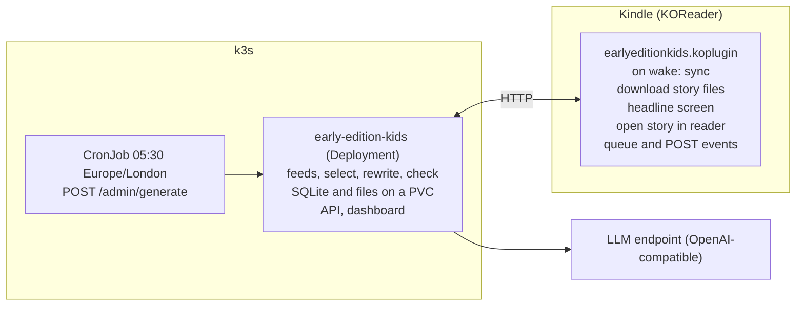
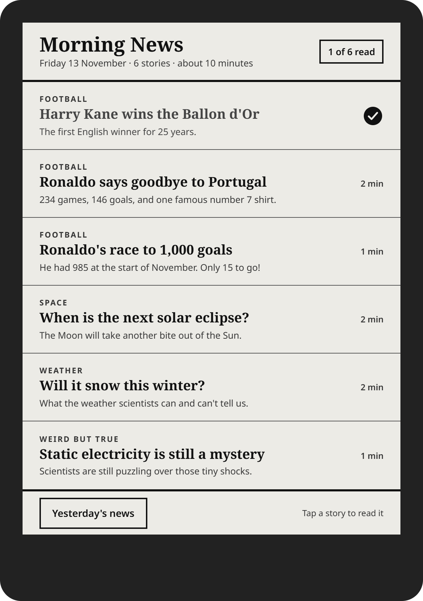
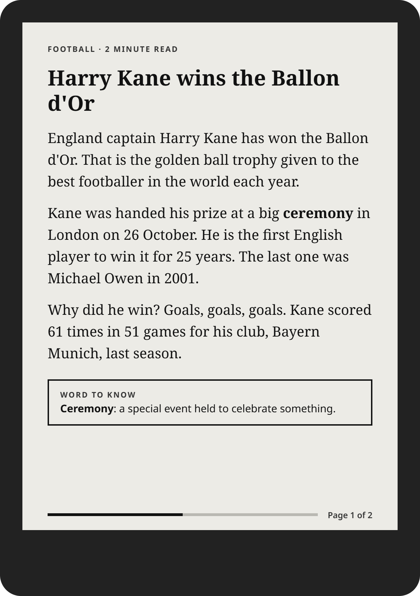
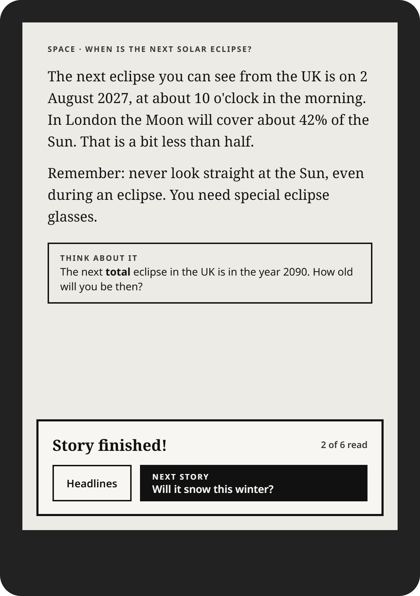

# Early Edition Kids: a daily kids' news brief for KOReader

Design handover for a coding agent. The product name is Early Edition Kids; the child sees "Early Edition" as the title on his Kindle.

Revised on 13 November 2026 after a review against the live feeds and the KOReader source. Section 13 lists what changed.

## 1. Goal

Every school morning an 8 year old picks up his Kindle and finds about six short news stories, written at his reading level and weighted toward what he likes. He taps a headline, reads for a minute or two, and moves to the next. A parent can see what he read and what he skipped, and that feeds back into tomorrow's selection.

Success looks like: the issue is ready on the server before 07:00 with no adult action, it reaches the device shortly after he wakes it (section 5.1; measure the delay on the device), a story takes 1 to 2 minutes to read, and nothing upsetting ever reaches him.

## 2. Context and constraints

- **Reader device:** Kindle Paperwhite 7th generation (PW3), jailbroken, running KOReader. Screen 1072 x 1448 px at 300 ppi, greyscale e-ink, touch only, slow refresh. No images in v1; story photos came later (CONTRACT.md "Story photos").
- **Server:** a k3s cluster on the home LAN. The Kindle reaches it over Wi-Fi by plain HTTP on the LAN (confirm with the owner, see section 12).
- **Writer model:** Claude Opus 5.5 through the Anthropic API by default, for both writing and checking (`LLM_PROVIDER=anthropic`). Any OpenAI-compatible chat completions endpoint (OpenRouter, a local model) is the alternative (`LLM_PROVIDER=openai` with a base URL). Provider, API key and model names are configuration.
- **Reader:** UK child, British English, UK-centric news.
- **KOReader only runs plugins while it is in the foreground.** The Kindle must be left in KOReader overnight. Document this in the README.
- **The Kindle cannot wake itself to download.** No scheduled-wake support was found in KOReader's Kindle device code, so the download starts when he wakes the device, not before.

## 3. Architecture

[architecture.md](architecture.md) has diagrams of the system as built.

Two deliverables: `server/` (one container plus manifests) and `plugin/earlyeditionkids.koplugin/`.

## 4. Server

Stack: Node.js and TypeScript run with `tsx` (no compile step; `tsc --noEmit` for type checks), Express, SQLite (better-sqlite3), cheerio, nunjucks, vitest. The owner does not want Python in this project. One process, one replica. The CronJob calls the service's endpoint rather than writing to the database itself, so SQLite has a single writer.

### 4.1 Daily generation pipeline (`POST /admin/generate`)

1. **Fetch** every configured feed. Keep items published in the last 48 hours. Feeds resurface old items, so filter on the item's own date.
2. **Filter** the candidates:
   - drop repeated URLs within the run (Newsround lists some items twice);
   - drop non-articles using each feed's exclude patterns (section 4.5): videos, quizzes, picture galleries, "have your say" prompts;
   - drop anything whose title or summary matches the blocklist;
   - de-duplicate against stories used in the last 14 days (by URL and by normalised title).
3. **Select** with one LLM call (section 4.2). Input: each candidate's title, feed summary, source name and topic hint, plus topic weights, pinned and blocked topics and the child's age. No article text. Output: `STORY_COUNT` picks and 4 reserves, each with a topic.
4. **Extract** article text for the picks only: prefer the feed's full content (`content:encoded`), else fetch the page and take paragraph text from the main article element. Truncate to about 6,000 characters. If fewer than about 150 words come back, drop the pick and take a reserve.
5. **Rewrite** each pick with its own LLM call (section 4.2). The calls can run in parallel, three at a time.
6. **Check** each story (section 4.3). On failure, rewrite once more with the reason supplied; on a second failure, drop it and take a reserve.
7. **Store** the issue: one row per story, plus one standalone HTML file per story and a JSON index.
8. **Fallback:** if the LLM is unreachable or fewer than 3 stories pass (fewer than `STORY_COUNT` when it is under 3), publish a catch-up issue (section 4.4). Feed text is never published unrewritten, from any source.

A normal run makes about 13 LLM calls: one to select, six to rewrite, six to check.

The endpoint is idempotent per date: calling it again regenerates only with `?force=true`. A forced run creates a new version of the issue (section 4.6) and keeps the old story rows, so events already recorded against them still resolve.

### 4.2 Editorial rules for the LLM prompts

**Skip entirely, in both selection and rewriting:** war and terrorism detail, violent crime, abuse, death of children, graphic disasters, sexual content, gambling, celebrity disputes. Sports stories stay on the sport, not on rows or scandals; a manager leaving or being sacked is fine as plain news. Rival clubs (config `rival_clubs`, against `favourite_team`) may get one light-hearted, good-natured line from a fan of his team, never mean or personal. A kids' source is not exempt: Newsround covers wars.

**Selection:**

- Choose `STORY_COUNT` stories (default 6). Roughly half from the top-weighted topics, at least one from a different topic, and one "wildcard" outside his usual picks.
- No two picks about the same event. When two feeds cover one event, prefer the kids' source.
- Return 4 reserves in preference order.
- Output: a single JSON object, `{picks: [{candidate_id, topic}], reserves: [{candidate_id, topic}]}`.

**Rewriting, one story per call:**

- 120 to 200 words (config `story_words`; 100 to 160 if unset), short sentences, British English, reading age 8. Explain at most one hard word.
- Each story gets: `title` (max 45 characters), `teaser` (max 60 characters), `topic` (from the configured list), `body` (3 to 5 paragraphs), optional `word_to_know` (word plus definition), `think_about_it` (one open question), `source_name`, `source_url`.
- Facts must come from the supplied article text only. No invented numbers, quotes or dates, and no numbers worked out from other numbers. Dates are written out ("26 October"), not "yesterday".
- Tone: curious and upbeat, never babyish, never frightening.
- Output: a single JSON object.

For every call: do not rely on `response_format`; strip code fences and parse defensively.

### 4.3 Validation and checking before publishing

Each story must pass all three stages.

**Mechanical:**

- JSON parses and matches the schema; lengths within limits; topic is in the configured list.
- `source_url` is the URL of the candidate that was supplied.
- Every number in the title, teaser and body also appears in the source text. Compare digit sequences with commas stripped. `word_to_know` and `think_about_it` are exempt.
- A plain blocklist of words (configurable) rejects a story if matched.

**Checker call:** a separate LLM call that sees the source text and the finished story and returns `{safe, supported, reasons}`.

- `safe`: nothing from the skip list, nothing that would frighten an 8 year old.
- `supported`: every name and claim in the story is in the source text.
- It uses the writer's endpoint by default; `CHECK_LLM_MODEL` can point it at a different model. The writer never marks its own work.

**Issue level:** fewer than 3 stories passing means the run failed; use the fallback. When `STORY_COUNT` is under 3, every story must pass instead.

**Kept with the story:** what these checks found for the version that passed is stored in `stories.checks` as JSON: the numbers in the title, teaser and body with whether each is in the source text, the checker's verdict and reasons, how many attempts it took, and the writer and checker models that answered. A catch-up copy carries its original's. Stories made before this (migration 5) have none.

### 4.4 Topic weighting and the catch-up fallback

Topics live in configuration with a base weight. Starting set:

| Topic | Base weight | Notes |
|---|---|---|
| Liverpool FC | 3 | His team: aim for one Liverpool story a day when there is a suitable one; on the football only, no gossip or rows |
| England | 3 | England men's team |
| Football | 3 | Other clubs. Premier League first; players to favour: Messi, Ronaldo, Harry Kane |
| Science | 3 | |
| Space | 2 | |
| Animals and nature | 2 | |
| Games and tech | 1 | |
| Weather | 1 | UK weather when notable (snow, storms, eclipses) |
| Weird but true | 1 | one a day at most |

**Why not finish rate.** Stories are one or two pages long, so "reached the last page" is true for a one-page story the moment it opens. The weighting uses a stricter signal worked out on the server:

- A story's expected reading time is `word_count / READING_WPM` minutes (`READING_WPM` default 90). The `minutes` shown to the child is the same figure rounded, minimum 1.
- A story is **engaged** when it was opened, the last page was reached, and active reading time was at least half the expected time.
- A story is **shown** when its issue has a `list_shown` event. Days when he never picked up the Kindle do not count against any topic.

Per topic, over the last 14 days: engagement rate = (engaged + 1) / (shown + 2). The added 1 and 2 keep a topic with little or no data near the middle instead of swinging on one story.

Effective weight = base weight x (0.5 + engagement rate), so between 0.5x and 1.5x base. Parents can pin or block a topic from the dashboard; that overrides the maths.

**Catch-up fallback.** When a run fails, build the issue from stories in the last 7 days that no device opened, newest first, up to `STORY_COUNT`. They were already rewritten and checked. Store them as copies with new ids and `reused_from` set, and mark the issue `fallback: true`. If fewer than 3 are available (fewer than `STORY_COUNT` when it is under 3), publish nothing: `/api/issue/today` stays 404 and the Kindle keeps showing the previous issue.

### 4.5 Sources

Configured as a list of `{name, url, kids_source: bool, topic_hint, exclude_url_patterns, exclude_title_patterns}`.

All four feeds below responded from the owner's network on 13 November 2026. Check they also respond from the cluster.

| Feed | URL | Kids | Full text in feed | Items in 48 hours |
|---|---|---|---|---|
| BBC Newsround | `https://feeds.bbci.co.uk/newsround/rss.xml` | yes | no, summaries of about 26 words | about 10 real articles |
| Science News Explores | `https://www.snexplores.org/feed` | yes | yes, 300 to 2,700 words | 1 to 2 |
| BBC Sport football | `https://feeds.bbci.co.uk/sport/football/rss.xml` | no | no, summaries | about 30 |
| BBC Sport Liverpool | `https://feeds.bbci.co.uk/sport/football/teams/liverpool/rss.xml` | no | no, summaries | about 10 (checked 13 November 2026: 24 items, current) |
| BBC science | `https://feeds.bbci.co.uk/news/science_and_environment/rss.xml` | no | no, summaries | about 15 |

- **Newsround** mixes real articles with videos (`/videos/` in the URL), "Watch Newsround", weekly quizzes, "have your say" prompts, picture galleries and old explainers carrying dates back to 2018. It also carries war coverage. Start its exclude patterns with `/videos/`, `watch_newsround`, `^Quiz`, `in pictures`.
- **Science News Explores** is pitched older than 8, so always rewritten.
- **The two BBC adult feeds are required, not optional.** Football is his top topic and Newsround carries only one or two football items a day.
- `kids_source` is a selection hint only. It exempts nothing from rewriting or checking.

Stories are short rewrites in our own words with the source named, for use inside one household. Do not redistribute. Page fetches are limited to the six or so picks a day.

### 4.6 Data model (SQLite)

- `issues(date PK, version, created_at, fallback, story_count)`
- `stories(id PK, issue_date, issue_version, position, topic, title, teaser, body_html, word_to_know, think_about_it, source_name, source_url, word_count, reused_from NULL, hidden DEFAULT 0)`
- `events(id PK, device_id, client_event_id, story_id NULL, type, ts, received_at, payload_json)` with a unique key on `(device_id, client_event_id)` so re-uploads are harmless. `ts` is the device clock; `received_at` is the server's.
- `topic_overrides(topic PK, mode)` where mode is `pin` or `block`

Regenerating an issue bumps `issues.version` and inserts new story rows. Old rows stay.

### 4.7 API

| Method and path | Purpose |
|---|---|
| `GET /api/issue/today` | Today's issue by the Europe/London date: `{date, version, fallback, title, stories:[{id, position, topic, title, teaser, minutes, path}]}`. 404 if today's has not been generated. Never returns an older issue. |
| `GET /api/issue/{date}` | Same for a back issue |
| `GET /issues/{date}/v{version}/{position}.html` | One story as standalone HTML. The plugin takes this from `path`; it never builds it. |
| `POST /api/events` | Body `{device_id, events:[...]}`; returns the accepted `client_event_id`s |
| `POST /admin/generate` | Run the pipeline; needs `X-Admin-Token` |
| `GET /dashboard` | Parent page; HTTP basic auth |
| `GET /healthz` | Liveness |

### 4.8 Story HTML

Self-contained, no external assets, minimal inline CSS that KOReader's HTML engine handles: topic and read-time line, `h1` title, paragraphs, a bordered "Word to know" box, a bordered "Think about it" box, a small source line. No scripts, no links, and no images except the story photo the Kindle asks for with `?photo=1`, which is a file beside the page (CONTRACT.md "Story photos").

Set `<title>` to "Topic · Headline". The mockups show that text at the top of page 2 and a "Page 1 of 2" bar at the bottom; both come from KOReader's own status bars, not from the HTML (section 11). How KOReader renders this HTML has not been checked; look at it in the emulator early.

### 4.9 Parent dashboard

Server-rendered, no JavaScript framework needed. Mobile-first: the owner mostly uses it on a phone. Pages: Today, a page per story (as he sees it, plus its reading stats), back issues, Find articles, Topics.

- **Find articles:** search the last 30 days of fetched feed items, or paste any article URL, and add it to today's issue or tomorrow's. Added stories go through the same rewrite and check (CONTRACT.md, "Parent-added articles").

- Last 14 days: per story, opened or not, reached the end or not, active reading seconds against expected seconds, engaged or not.
- Per topic: open rate, engagement rate, current effective weight, pin and block controls.
- Today's issue preview, with a "regenerate" button. If a device has already downloaded today's issue, the button says so and asks for confirmation.
- Per story in the preview: a link to the source article, so a parent can compare.
- Per story, a "hide" button (and "unhide"). A hidden story drops out of the API and the plugin removes it at its next sync (CONTRACT.md). Hiding only helps before he reaches the story, so check the preview early.
- Streak of days with at least one story engaged.

### 4.10 Kubernetes

- `Deployment` (1 replica, `Recreate` strategy), `Service`, `PersistentVolumeClaim` (1 Gi).
- Storage: k3s `local-path`. Do not put SQLite on NFS. `local-path` ties the pod to one node; if that node is lost, so is the reading history, which is acceptable for v1.
- The image must be multi-arch (`linux/amd64` and `linux/arm64`): the cluster has both kinds of node.
- `CronJob` with `timeZone: Europe/London`, schedule `30 5 * * *`, a curl container calling `/admin/generate`. `concurrencyPolicy: Forbid`. The `timeZone` field is stable from Kubernetes 1.27 (on by default from 1.25), so this targets the owner's new cluster, not the old v1.22 one.
- `ConfigMap`: feeds, topics, story count, child's age, reading speed, blocklist.
- `Secret`: `LLM_BASE_URL`, `LLM_API_KEY`, `LLM_MODEL`, optional `CHECK_LLM_MODEL`, `ADMIN_TOKEN`, dashboard password.
- Expose on the LAN with whatever the cluster already uses (Traefik ingress or a NodePort). Plain HTTP is acceptable on the LAN.

## 5. KOReader plugin

Lua, in `earlyeditionkids.koplugin/` with `_meta.lua`, `main.lua` and a user-editable `config.lua` (`server_url`, `earliest_fetch_hour`), copied from `config.example.lua`. On Kindle the plugins folder is normally `/mnt/us/koreader/plugins/`.

**Why a custom plugin.** A plugin-free first version was considered: the server publishes an Atom feed and KOReader's built-in News Downloader pulls it. The owner decided against it, for these reasons:

- News Downloader exposes no action that a wake-up profile can run, so every sync would need a tap.
- It saves each entry as a date-prefixed EPUB file, so the "headline list" would be a list of filenames.
- It gives no tracking, and no room for the child's own reading stats (section 5.5).

Some of the KOReader names below were checked against the `master` branch on 13 November 2026; section 5.4 says which. Read the current repository before writing code (the `newsdownloader` and `opds` plugins are the closest references) and adjust.

### 5.1 Behaviour

1. **Sync on wake.** On start and on resume from sleep, sync if either is true:
   - it is after `earliest_fetch_hour` (default 5) and the stored issue is not today's;
   - there are queued events to upload.

   A sync brings Wi-Fi up, uploads queued events, calls `GET /api/issue/today`, downloads each story file to `<koreader data dir>/earlyeditionkids/<date>/`, and saves the index. Take the issue date from the server's response, since the Kindle clock may be wrong.
2. **Back off sensibly.** After a 404 (issue not ready yet), wait 30 minutes before the next automatic try. After a network failure, wait 2 minutes. Automatic failures are silent apart from a log line. A "Check for news" item on the headline screen and in the menu syncs at once, ignores the back-off and reports the result.
3. **Say what is happening.** Wi-Fi takes several seconds to reconnect after wake, so the issue arrives a little after he picks the Kindle up. While a new issue is downloading, show a short "Getting today's news…" notification.
4. **Show the headlines.** After a successful fetch, if no book is open, show the headline screen straight away. If a book is open, show a short notification instead. The screen is also reachable from the main menu ("Early Edition Kids").
5. **Read a story.** Tapping a headline opens that story's HTML file in the normal reader, so page turns, font size and so on are standard KOReader.
6. **End of story.** When he turns forward from the last page, show a panel: "Story finished!", the read count, a "Headlines" button and a "Next story" button naming the next unread story.
   - KOReader raises its end-of-book event only when a forward page turn fails to move, so the panel appears one tap after the last page. It never covers text he has not read.
   - KOReader's own handler for that event is registered before plugins and shows its own pop-up. For Early Edition Kids stories the plugin must replace that handler, not just listen alongside it.
   - Closing a story any other way goes back to the headline screen with no panel.
7. **Leave his book alone.** KOReader records every opened file as the last-opened file and in the history. Before opening the first story, remember his last-opened book. When he leaves Early Edition Kids, restore it and remove the story files from the history, so the Kindle next opens his book, not a news story.
8. **Track.** While an Early Edition Kids story is open, record the events in section 5.3. Queue them in a settings file and upload at the next sync.
   - Also append each closed story to a small reading log on the device: date, story id, topic, title, active seconds, whether the last page was reached. The log is not cleared when events upload and is not removed by the 7-day tidy; keep a year of it. It costs little now and is what the later stats screen reads (section 5.5).
9. **Handle a regenerated issue.** If a sync finds a higher `version` for the stored date, replace the stored issue only if he has not opened any of its stories. Otherwise keep what he has started.
10. **Tidy.** Keep 7 days of issues on the device; delete older folders along with the reading-position files KOReader creates for them.

### 5.2 Screens (see the mockups)

- **Headlines:**
  - Header: title "Early Edition" (the config `title`), then "date · N stories · about M minutes", with "N of M read" in a box on the right. M minutes is the sum of the stories' `minutes`.
  - One large row per story: topic label, headline, one-line teaser, and either a read-time or a tick if read. A read row is greyed. Rows are at least 90 px tall at 1072 px width scale-equivalent; this is for a child's finger.
  - A story gets its tick when he reaches its last page.
  - A catch-up issue (`fallback: true`) says "Stories you missed" under the title.
  - Footer: a "Yesterday's news" button, which reads the issues already stored on the device and needs no network, and "Check for news".
  - This needs a custom widget. KOReader's stock `Menu` rows have one text font plus a right-hand label and cannot show the three-tier row in the mockup.
- **Story:** rendered by the reader from the HTML in section 4.8.
- **Finished panel:** as in 5.1 step 6, docked at the bottom of the screen as in the mockup. A stock `ButtonDialog` is an acceptable first version.

Greyscale only, no animation, minimise full-screen refreshes.

### 5.3 Events

Each event: `client_event_id` (UUID), `story_id` (null for the two issue-level events), `type`, `ts` (device epoch seconds), `payload`.

| Type | Payload |
|---|---|
| `issue_downloaded` | `{date, version}` |
| `list_shown` | `{date, version}` |
| `story_opened` | none |
| `story_closed` | `{active_seconds, pages_total, max_page, finished}` |

`active_seconds` excludes time asleep: pause the timer on suspend, resume on wake. `finished` is true when `max_page == pages_total`. The plugin reports these raw figures; the server decides whether a story was engaged (section 4.4). The Kindle clock may be wrong, so the server also stamps its own receive time.

### 5.4 KOReader pieces expected to be needed

Checked against `master` on 13 November 2026:

- `ReaderUI:showReader(file, ...)` and `ReaderUI:switchDocument(new_file, ...)` exist in `frontend/apps/reader/readerui.lua`.
- `NetworkMgr:runWhenOnline(callback)` and `NetworkMgr:turnOnWifiAndWaitForConnection(callback)` exist in `frontend/ui/network/manager.lua`.
- The `EndOfBook` event is sent from `readerrolling.lua` only when a forward move leaves the page unchanged.
- `ReaderStatus:onEndOfBook()` shows a pop-up by default (`end_document_action`), and `ReaderStatus` is registered in `readerui.lua` before plugins are loaded.
- `readerui.lua` adds each opened file to the history, which also updates `lastfile`.
- `ui/widget/menu` supports multi-line text and a right-hand `mandatory` label, in one font.
- No scheduled-wake code was found in `frontend/device/kindle/device.lua`.

Not checked:

- Plugin base: `WidgetContainer:extend{}`, `self.ui.menu:registerToMainMenu(self)`, `addToMainMenu(menu_items)`.
- HTTP via `socket.http` with `ltn12` sinks and `socketutil` timeouts.
- `Notification` for the toast; the container and text widgets for the custom headline screen.
- Events: `onResume`, `onSuspend`, `onReaderReady`, `onPageUpdate`, `onCloseDocument`.
- Storage: `LuaSettings` in the settings dir, `DataStorage` for paths.
- The cleanest way to replace the built-in end-of-book handler for one document, and to remove files from the history.

The plugin is instantiated separately for the file manager and for the reader, so all state must live in the settings file, not in memory.

### 5.5 Later: reading stats for the child

Not in v1, but the owner expects to want it, so v1 must not make it hard.

- **What it is:** a screen for the child, in the same style as the headline screen: stories read this week, the current streak, and which topics he reads most. A one-line version ("4 stories this week") could also sit in the headline header.
- **Where the numbers come from:** the reading log on the device (section 5.1 step 8), so it works with Wi-Fi off and updates the moment he finishes a story. The server's events remain the source for the parent dashboard.
- **What v1 does for it:** keeps the reading log, and builds the headline screen from plain container and text widgets in its own module, so a second screen can reuse the row, header and button pieces.
- **Tone:** counts and streaks only. Nothing that reads as a score or a telling-off for a missed day.

## 6. Privacy

All reading data stays on the home server. Nothing about the child is sent to the LLM: the prompts contain age, topic names, weights and favourite players only. The device identifies itself with a random `device_id`.

## 7. Testing

- **Server:** unit tests for feed parsing, the candidate filter, de-duplication, validation (including the number check), weighting and the catch-up fallback. A stub LLM with canned JSON for the select, rewrite and check calls, so the pipeline runs in CI with no key. A snapshot test of the story HTML.
- **Plugin:** develop against the KOReader desktop emulator first. Keep HTTP, queueing, back-off and date logic in plain Lua modules that can be tested without the UI.
- **On device:** the owner copies the plugin over USB and sends back `crash.log` if it fails. Expect a couple of rounds. Time how long the issue takes to appear after wake.

## 8. Acceptance criteria

1. With the stub LLM, `POST /admin/generate` creates an issue of 6 stories and `GET /api/issue/today` returns it.
2. With a real endpoint, stories are within the configured word range (`story_words`, 120 to 200) and pass validation. A blocked word causes rejection, and so does a number that is not in the source.
3. A story the checker marks unsafe is not published; a reserve takes its place.
4. LLM down: a catch-up issue is published from unopened earlier stories, or nothing is published. No feed text is ever published unrewritten.
5. The plugin syncs on wake, shows six headlines, opens a story, shows the finished panel when he turns past the last page, and marks it read.
6. After reading stories, his own book is still what KOReader opens next.
7. With Wi-Fi off, reading still works from the downloaded files and events upload later, exactly once.
8. Regenerating an issue he has started does not change what is on his Kindle, and earlier events still show on the dashboard.
9. The dashboard shows opened, reached the end, reading time and engaged per story, and topic weights move after a few days of data.

## 9. Build order

1. Server skeleton, data model, stub-LLM pipeline (select, rewrite, check), story HTML.
2. Real feeds and filters, real LLM, validation, checker, catch-up fallback.
3. Kubernetes manifests; run it on the cluster for a few days and read the output as a parent.
4. Plugin: sync and headline screen in the emulator.
5. Plugin: tracking, finished panel, event upload.
6. Dashboard and topic weighting.
7. On-device testing.

Step 3 before any plugin work is deliberate: the stories are the product, and they can be judged in a browser.

## 10. Out of scope for v1

Images, audio, multiple children, quizzes, a parent approval queue (parents can hide and add stories, but nothing waits for approval), a general web news search (search covers the configured feeds plus pasted URLs), an EPUB or OPDS export, remote access from outside the LAN, a scheduled overnight download, the child's stats screen (section 5.5; only its reading log is in v1).

## 11. Mockups

Three greyscale Kindle screens (headlines, story page, end of story) are in [`images/mockups/`](images/mockups/). The sample stories in them are illustrative.

| Headlines | Story page | End of story |
|:---:|:---:|:---:|
|  |  |  |

Where the build will differ from the mockups:

- **End of story:** the mockup shows the finished panel on the last page. It will appear one tap later (section 5.1 step 6).
- **Story page furniture:** the "Topic · Headline" line at the top of page 2 and the "Page 1 of 2" progress bar are KOReader's own status bars, set in KOReader's settings, not drawn by the story HTML.
- **Source line:** section 4.8 has one; the mockups do not show it.

## 12. Open decisions (defaults used above)

| Decision | Default assumed | Ask the owner |
|---|---|---|
| Parent approves each issue before 07:00? | No, fully automatic, with a separate checker call | Add an approval step later if needed |
| Does the child know reading is tracked? | Yes, shown as "N of M read"; in v1 the streak is on the parent dashboard only | The owner expects to show weekly counts and the streak on the Kindle later (section 5.5) |
| Comprehension quiz per story? | No, only "Think about it" | |
| How the Kindle reaches the server | Plain HTTP on the LAN, fixed hostname or IP | Confirm the address |
| Weekends and school holidays | An issue every day | Weekdays only? |
| Checker model | Same model as the writer | Use a different one for independence? |
| Final name | Early Edition Kids — decided | |

## 13. Changes in the 13 November 2026 revision

- **Pipeline:** one select-and-rewrite call became select, then extract, then one rewrite call and one checker call per story (4.1 to 4.3).
- **Safety:** added the checker call and the number check. The fallback no longer publishes feed summaries; it reuses unopened stories (4.4).
- **Feeds:** all four verified; filters added for Newsround's non-articles; the BBC adult feeds are now required (4.5).
- **Weighting:** finish rate replaced by an engagement rate with smoothing; the unused clamp removed (4.4).
- **Data and API:** issue versions, `reused_from`, the missing event columns, and a firm meaning for `/api/issue/today` (4.6, 4.7).
- **Plugin:** sync also runs when events are queued, shorter back-off after network failures, a manual check, end-of-story behaviour matched to KOReader, his own book restored, custom headline widget (5.1, 5.2, 5.4).
- **Kubernetes:** multi-arch image, `timeZone` version note, storage note (4.10).
- **Decision:** the custom plugin stays; a News Downloader first version was considered and rejected (5). A reading log was added to v1 so a stats screen for the child can follow (5.1, 5.5).
