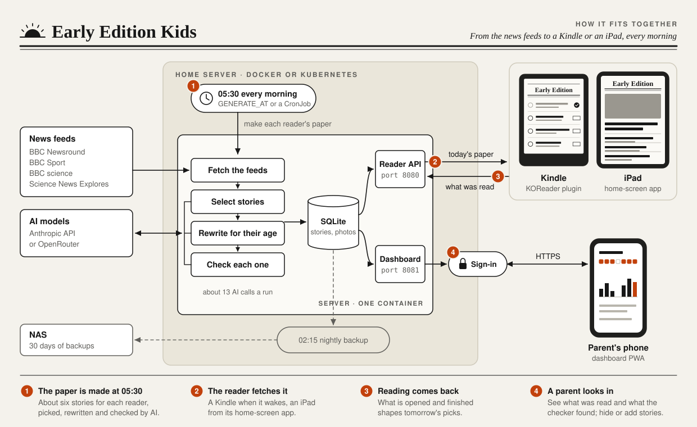
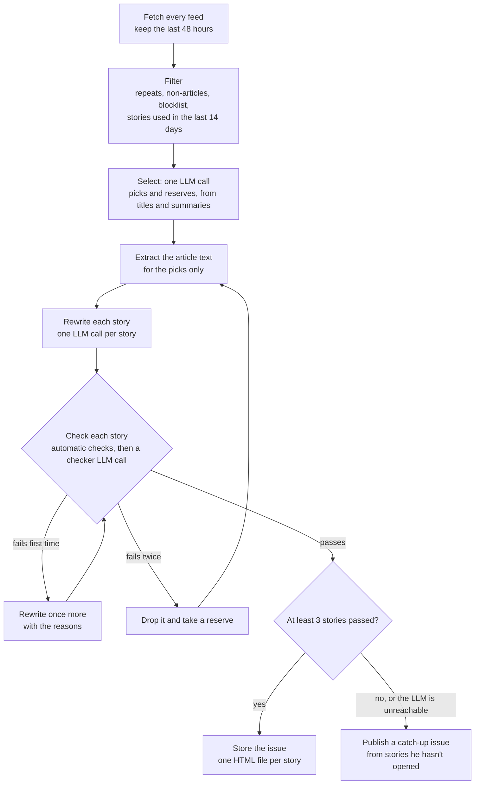
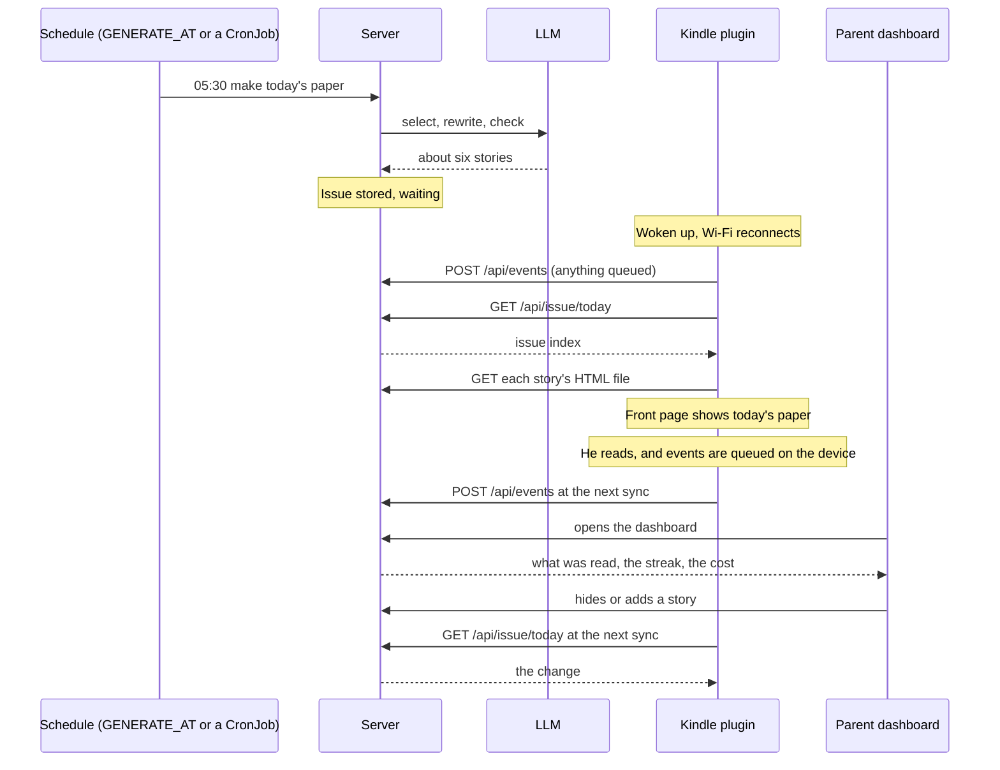

# Architecture

Three pictures: what runs where, how the paper is made each morning, and how it reaches the Kindle. [DESIGN.md](DESIGN.md) has the reasoning and [CONTRACT.md](CONTRACT.md) has the exact interfaces.

## What runs where

One server process does everything: a single Docker container, or one pod on Kubernetes. It listens on two ports so the Kindle and the dashboard never share a route: the Kindle's port is on the LAN only, and the dashboard's should only be reachable through a login, such as Authelia. The picture shows the Kubernetes setup; with Docker, the server's own `GENERATE_AT` schedule takes the CronJob's place.

<picture>
  <source media="(prefers-color-scheme: dark)" srcset="images/architecture/system-dark.svg">
  
</picture>

The picture is drawn by [`tools/system-diagram.mjs`](tools/system-diagram.mjs), which writes a light and a dark version. To change it, edit the script and run `node docs/tools/system-diagram.mjs`.

## The daily pipeline

`POST /admin/generate` runs this once a morning. A normal run makes about 13 LLM calls: one to select, six to rewrite and six to check. [DESIGN.md, section 4.1](DESIGN.md#41-daily-generation-pipeline-post-admingenerate) has the detail of each step.

Feed text is never published unrewritten. If too few stories pass, the catch-up issue reuses stories that were already rewritten and checked on an earlier day.

## A morning, end to end

The Kindle can't wake itself, so the paper is made at 05:30 and waits. The download starts when the Kindle is woken, which is why the headlines appear a few seconds after it is picked up.

The plugin syncs on start and on wake when any of these is true ([CONTRACT.md, plugin sync rules](CONTRACT.md#plugin-sync-rules-so-the-server-can-rely-on-them)):

1. It is past the earliest fetch hour and it has no issue for today.
2. It has events queued.
3. It has today's issue and last checked more than 30 minutes ago. This is how hidden stories and new versions reach it.

What he reads also feeds back: tomorrow's selection is weighted toward the topics he opens and finishes ([DESIGN.md, section 4.4](DESIGN.md#44-topic-weighting-and-the-catch-up-fallback)).
