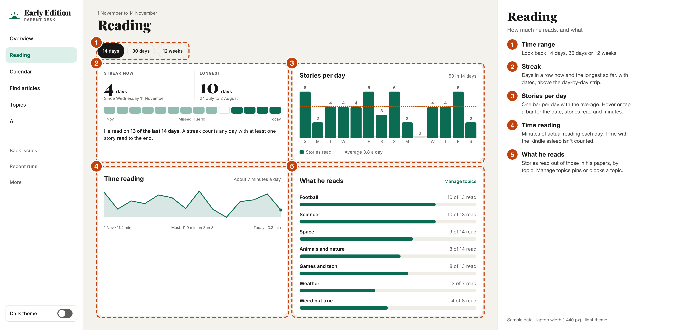
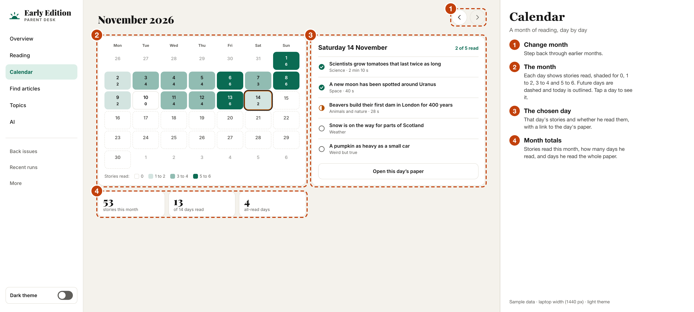
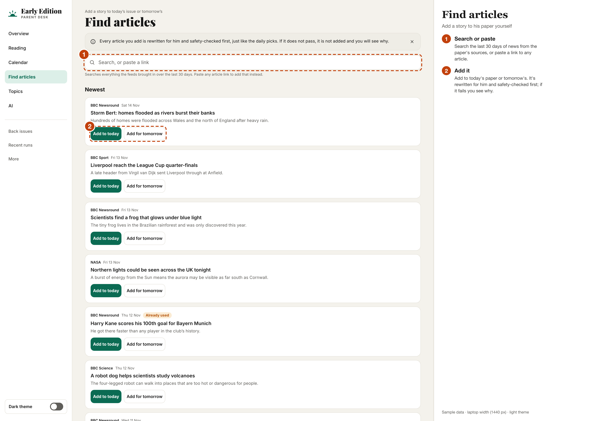

# The parent dashboard

A React PWA served by the server at `/dashboard/`, behind Authelia. It shows what was read, lets a parent hide or add stories, and chooses which AI model writes the paper.

Each screenshot below has numbered callouts with a key on its right. They show sample data at laptop width in the light theme. Click an image to see it full size.

## Overview

Everything at a glance: the reading streak, stories per day, this month's calendar, AI cost and today's paper.


## Reading

How much he reads and which topics, over 14 days, 30 days or 12 weeks.



## Calendar

A month of reading, day by day. Tap a day to see its stories.



## Find articles

Search the last 30 days of news from the paper's sources, or paste a link, and add the story to today's paper or tomorrow's. It is rewritten and safety-checked first.



## AI

Which model writes and which checks, what each costs, and how the month's spend compares with the limit.


## Pages without a screenshot here

- **Topics:** pin or block a topic.
- **Share:** six picture cards (streak, today, his week, milestone, words learned, ask me about) to send to family. They are drawn in the browser; [CONTRACT.md](CONTRACT.md#share-cards-added-14-november-2026) has the rules.

## Remaking the screenshots

[`tools/annotate.mjs`](tools/annotate.mjs) draws the callouts and keys. Capture each page at 1440 px wide and 2x scale as `overview.png`, `reading.png`, `calendar.png`, `ai.png` and `find.png` in one folder, then run:

```sh
node docs/tools/annotate.mjs /path/to/captures
```

It writes the annotated images into `docs/images/dashboard/`. The callout positions are in the script, so they need updating when a page's layout changes.
