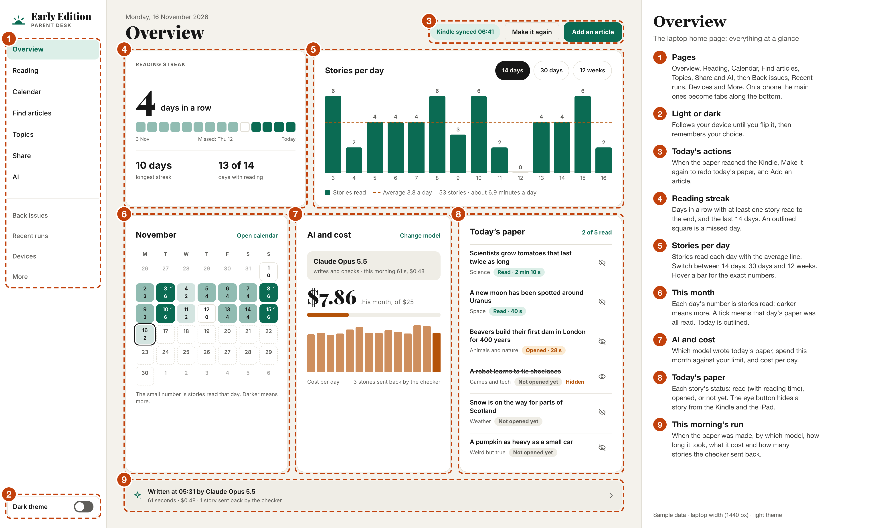
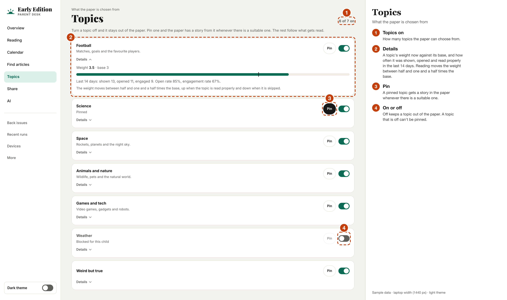
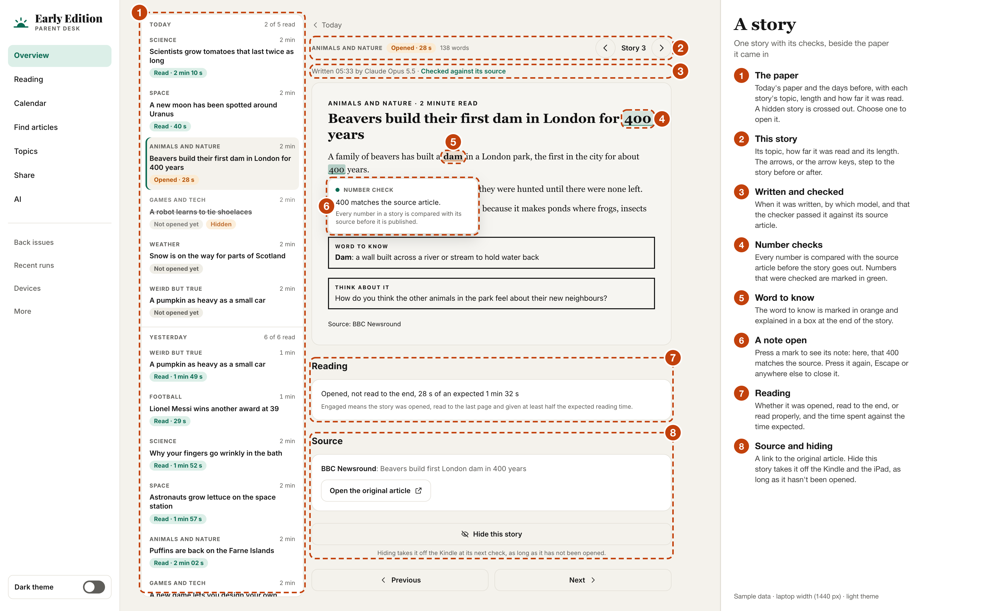
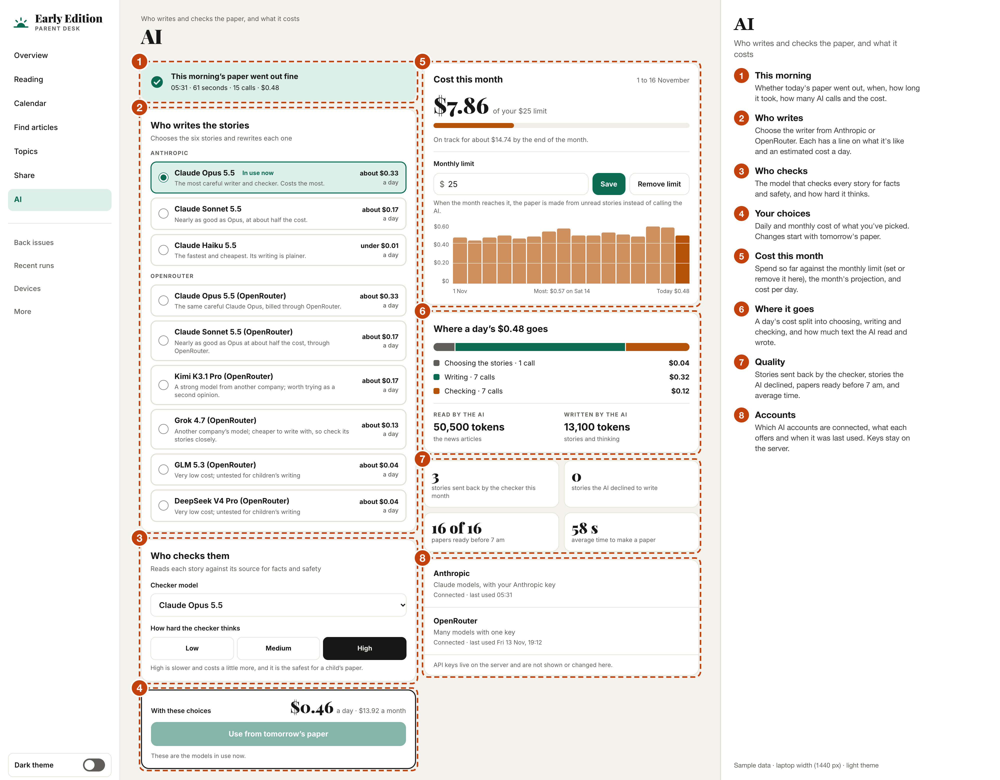

# The parent dashboard

A React PWA served by the server at `/dashboard/`, behind Authelia. It shows what was read, lets a parent hide or add stories, and chooses which AI model writes the paper.

Each screenshot below has numbered callouts with a key on its right. They show sample data at laptop width in the light theme. Click an image to see it full size.

## Overview

Everything at a glance: the reading streak, stories per day, this month's calendar, AI cost and today's paper.



## Reading

How much gets read and which topics, over 14 days, 30 days or 12 weeks.


## Calendar

A month of reading, day by day. Tap a day to see its stories.


## Find articles

Search the last 30 days of news from the paper's sources, or paste a link, and add the story to today's paper or tomorrow's. It is rewritten and safety-checked first.


## Topics

Turn a topic on or off, or pin it so the paper has a story from it whenever there is a suitable one. Details shows a topic's weight and how much of it gets read.



## A story

Each story opens beside the paper it came in. Numbers checked against the source article are marked in green and the word to know in orange; press a mark to see its note.



## AI

Which model writes and which checks, what each costs, and how the month's spend compares with the limit.



## Pages without a screenshot here

- **Devices:** the addresses and steps for putting the paper on a Kindle or an iPad, and the server's version, what it runs on and how long it has been running.
- **Share:** six picture cards (streak, today, the week, milestone, words learned, ask me about) to send to family. They are drawn in the browser; [CONTRACT.md](CONTRACT.md#share-cards-added-14-november-2026) has the rules.

## Remaking the screenshots

Run the dashboard against its mock data (`.claude/launch.json` has `early-edition-kids-web-mock`, on port 5173). [`tools/capture-dashboard.mjs`](tools/capture-dashboard.mjs) captures the seven pages in headless Chrome at 1440 px wide, 2x scale and the light theme. It pins Science, turns Weather off and opens Football's Details on Topics, and opens a number check on story 1711. [`tools/annotate.mjs`](tools/annotate.mjs) then draws the callouts and keys:

```sh
node docs/tools/capture-dashboard.mjs http://localhost:5173/dashboard/ /path/to/captures
node docs/tools/annotate.mjs /path/to/captures
```

It writes the annotated images into `docs/images/dashboard/`. The callout positions are in `annotate.mjs`, in CSS pixels, so they need updating when a page's layout changes. Restart the mock first if you have changed topics in it.
