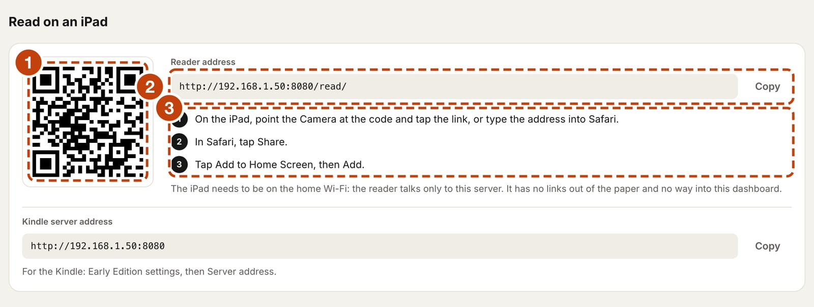
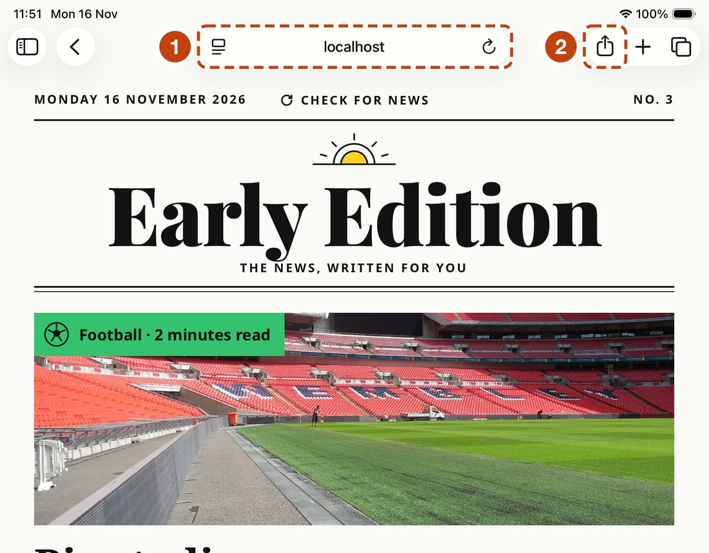
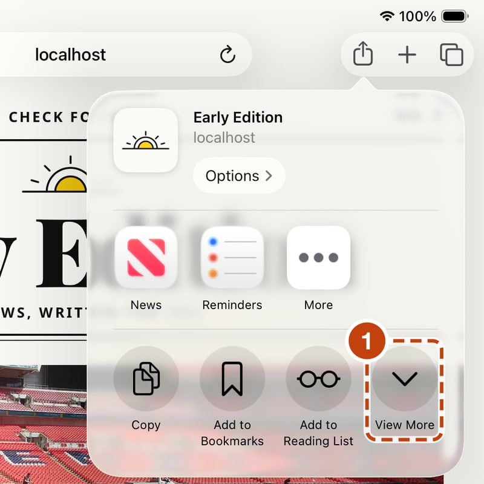
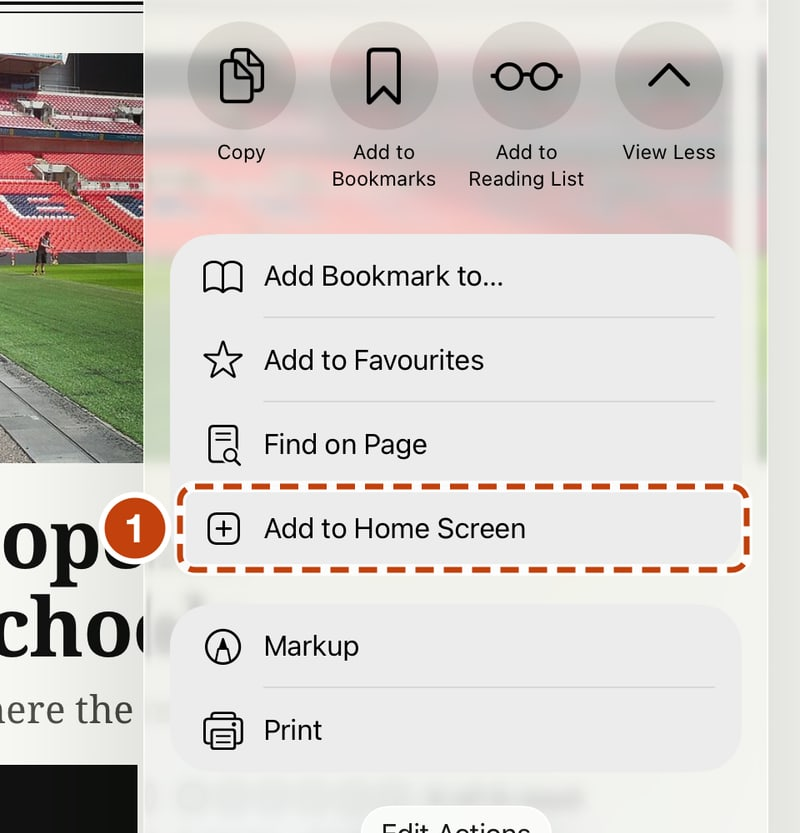
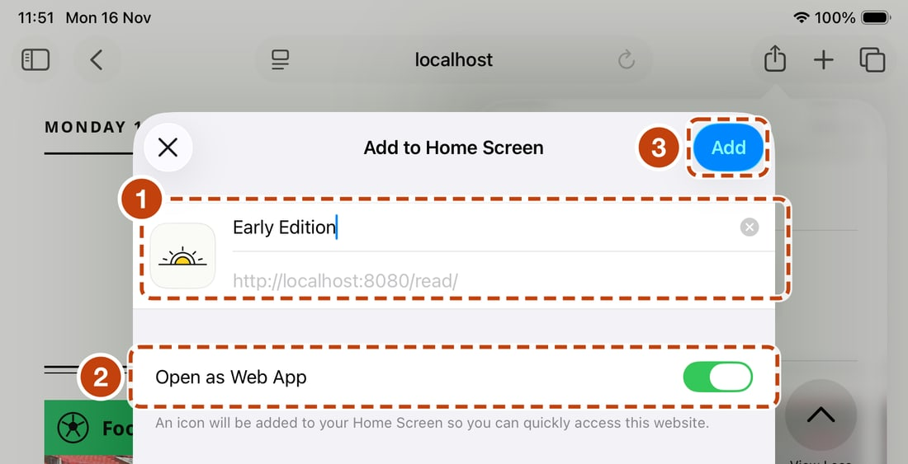
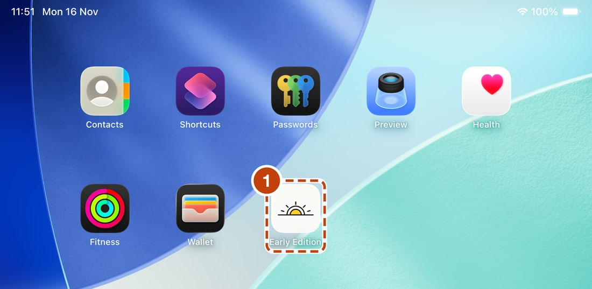
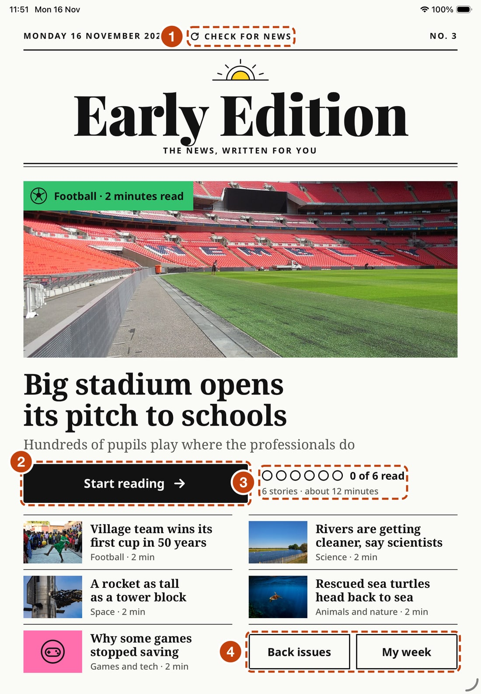
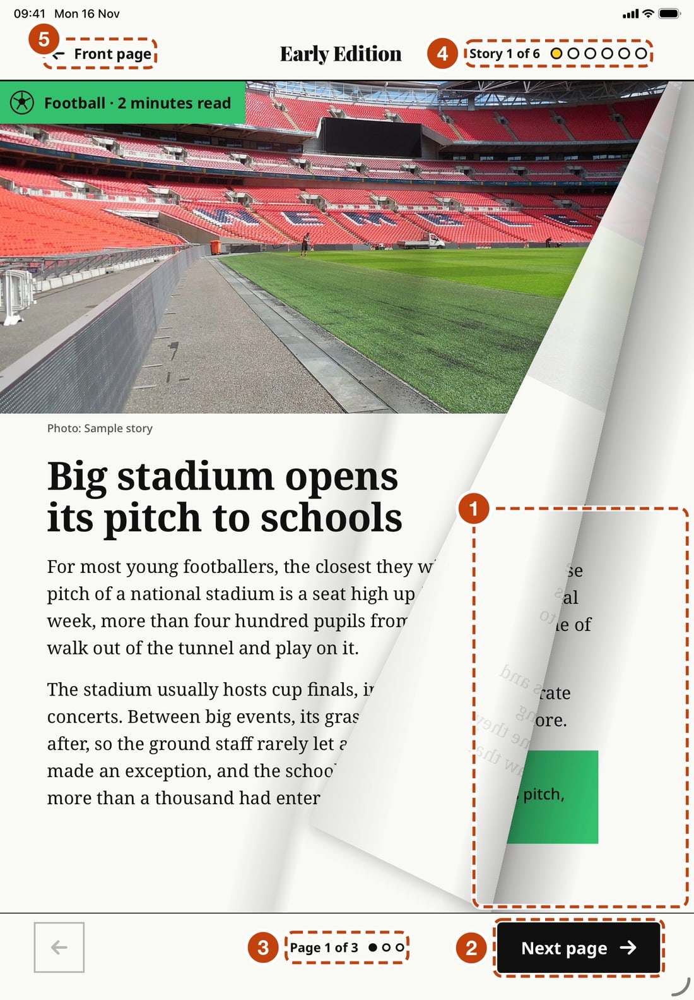
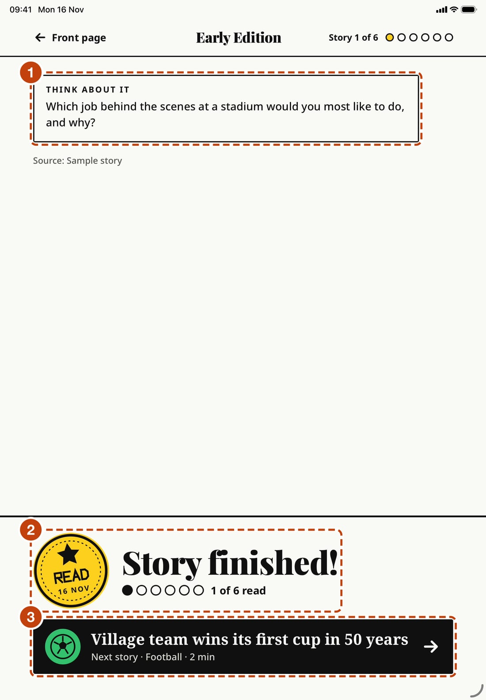

# Reading on an iPad

The iPad gets the same paper as the Kindle, with the stories' photos and colour. It isn't an App Store app: the server makes a small web app, and you add it to the iPad's home screen from Safari. After that it opens full screen from its own icon, like any other app.

Setting it up takes a couple of minutes. You need:

- an iPad on the same Wi-Fi as the server (the paper comes from the server, as it does for the Kindle);
- Safari on the iPad;
- the parent dashboard open on any device.

The screenshots are from the iPad simulator, showing the sample paper made by [`tools/sample-paper.mts`](tools/sample-paper.mts). The address bar shows `localhost` because of that; on your iPad it shows your server's address, such as `192.168.1.50`.

## 1. Find the reader's address

On the dashboard, open **Devices** (on a phone, it's under **More**) and find **Read on an iPad**.

1. **QR code.** Point the iPad's Camera at it and tap the link that appears. It opens the reader in Safari.
2. **Reader address.** Or type this into Safari on the iPad yourself. **Copy** puts it on the clipboard, to send it to the iPad another way.
3. **The steps,** in short: the rest of this page with pictures.

With [more than one child](settings.md#more-than-one-child), each child has their own reader address, ending in `/p/<id>/read/`. Pick the child with the switcher at the top of the dashboard first, and the card shows that child's address.

If the address on the card doesn't open on the iPad, the server has guessed it wrong. That happens behind a reverse proxy, where the dashboard's own address isn't the one the iPad can reach. Set `KINDLE_BASE_URL` to the address the Kindle uses, such as `http://192.168.1.50:8080`, and restart the server ([Settings](settings.md) has the details).

## 2. Open it in Safari

1. **The address bar** shows your server. This is the paper in an ordinary Safari tab; it becomes an app in the next steps.
2. **Share.** Tap it.

## 3. Add it to the home screen

1. **View More.** The first Share menu shows only a few actions; this shows the rest.

1. **Add to Home Screen.** Tap it.

On some versions of iPadOS, **Add to Home Screen** is already in the first list, further down; scroll to find it.

## 4. Name it and tap Add

1. **Name.** It starts as the paper's title from the config. With more than one child on one iPad, change it to each child's name so they can tell their icons apart.
2. **Open as Web App.** Leave it on. Turned off, the icon opens an ordinary Safari tab, with the address bar and the other tabs.
3. **Add.**

## 5. Open it from the icon

1. **The icon.** From now on, open the paper from here, not from Safari.

The app keeps its own reading history, separate from Safari's, so what was read in the Safari tab during setup doesn't carry over. You can close that tab.

## What your child sees

### The front page

The app opens full screen, with no address bar or tabs, and has no links out of the paper. The dashboard is on a different port and can't be reached from it.

1. **Check for news** looks for a new paper straight away. The app also checks by itself when it's opened on a new day or after a while away.
2. **Start reading** opens the first story not yet read.
3. **Progress:** a dot for each story, filled in when that story is finished.
4. **Back issues** has recent papers; **My week** shows the stories read this week, the reading streak and the words to know.

### Reading a story

1. **Turn the page** by swiping sideways: the page curls over with the finger, like a book. Tapping the right or left third of the page turns it too.
2. **Next page** does the same, for a child who prefers a button.
3. **Page dots** show how far through the story they are. There's no scrolling.
4. **Story 1 of 6** and the dots beside it show where they are in today's paper.
5. **Front page** goes back to the list of stories.

To have the whole paper on one long scrolling page instead, set `reader_mode: scroll` in the config. The type size follows `child_age`. [Settings](settings.md) has both.

### The end of a story

1. **Think about it** asks a question to talk over. A **Word to know** from the story comes just before it, as on the Kindle.
2. **Story finished!** The stamp appears once the last page is reached, and the story's dot fills in.
3. **Next story** opens the next one not yet read.

The dashboard counts reading on the iPad just like reading on the Kindle, so a child can use both.

### Sport

When the [Sport page](sports-page.md) is on for a child, the front page has a Sport strip under the stories. It never shows a score.

- **Closed first.** Until enough of today's stories have been read properly, the strip has a padlock and says how many more to go. Tapping it shows how far they have got, with the next story that would count as a button to tap. A story read too quickly to count has a fast-forward mark instead of the tick in the list, and says "Read too fast" (Sport or not). Turn this off, or change how much, on the dashboard's Sport page. Reading on the Kindle counts too.
- **Open:** the strip opens Sport: **Matches** (the latest matchday by day, with the scorers), **Table** and **Next** (the next fixtures). Tap a result for its line-ups, goals, cards, substitutions and injuries.
- It is the Sport page as it was fetched that morning, kept on the iPad, so it opens without the server too.

## Keeping it to the paper (optional)

The paper itself has no way out to the web or the dashboard, but the iPad still has its home screen and other apps. To keep a child in the paper:

- **Guided Access** locks the iPad to one app until you unlock it. Turn it on in **Settings › Accessibility › Guided Access**, then open the paper and triple-click the top button (or the Home button) to start.
- **Screen Time** sets time limits and downtime for the rest of the iPad. It's in **Settings › Screen Time**.

## If something goes wrong

- **"Can't reach the news right now".** The iPad isn't reaching the server. Check it's on the home Wi-Fi, then tap **Check for news**. The app still opens the papers it last loaded, and reading done offline is sent when it's back on the Wi-Fi.
- **The icon opens Safari, with an address bar.** **Open as Web App** was off when the icon was added. Delete the icon and add it again (steps 2 to 4).
- **Deleting the icon.** iPadOS deletes the app's data with it, so **My week** starts again from nothing on that iPad. The dashboard's reading history is kept on the server and isn't affected.
- **"Today's paper isn't ready yet".** The morning paper hasn't been made yet. Yesterday's is in **Back issues** while it's written.

## Photo credits

The sample stories are made up. The photos are from Wikimedia Commons:

- [Pitch side view, Wembley Stadium](https://commons.wikimedia.org/wiki/File:Pitch_side_view_-_Wembley_Stadium_-_geograph.org.uk_-_4624558.jpg) by Paul Gillett, [CC BY-SA 2.0](https://creativecommons.org/licenses/by-sa/2.0)
- [Shangani football match](https://commons.wikimedia.org/wiki/File:2015_03_09_Shangani_Football_Match-7_(16584782510).jpg) by AMISOM Public Information, [CC0](https://creativecommons.org/publicdomain/zero/1.0/)
- [River Thames and Port Meadow from Godstow Lock](https://commons.wikimedia.org/wiki/File:River_Thames_and_Port_Meadow_from_Godstow_Lock.jpg) by AstacopsisGouldi, [CC BY-SA 4.0](https://creativecommons.org/licenses/by-sa/4.0)
- [SpaceX booster, full stack](https://commons.wikimedia.org/wiki/File:Space_X_booster_Full_Stack.jpg) by Jenny Hautmann, [CC BY-SA 4.0](https://creativecommons.org/licenses/by-sa/4.0)
- [Green turtle swimming out for a breath](https://commons.wikimedia.org/wiki/File:Green_turtle_swimming_out_for_a_breath_at_the_GBR.jpg) by Ppmh21, [CC BY-SA 4.0](https://creativecommons.org/licenses/by-sa/4.0)

The callouts are drawn by [`tools/annotate-ipad.mjs`](tools/annotate-ipad.mjs).
