# The Kindle screens

What the child sees in KOReader. The plugin draws the front page, the headline list, the finished panel and back issues itself; stories open in KOReader's normal reader.

These are captures from the KOReader emulator at the Kindle Paperwhite's size. E-ink refresh, fonts and touch can only be judged on the real device.

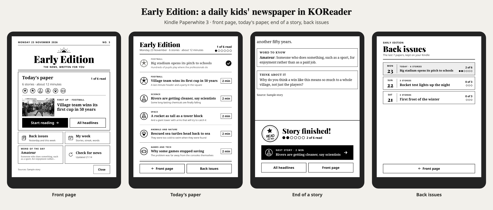

The feature sets (this one and Sport's, below) are made by [`tools/kindle-sets.mjs`](tools/kindle-sets.mjs) from the plugin's screenshot tour run on the sample papers; the script's header says how.

| Front page | Today's paper | A story | End of a story | Back issues |
|:---:|:---:|:---:|:---:|:---:|
| 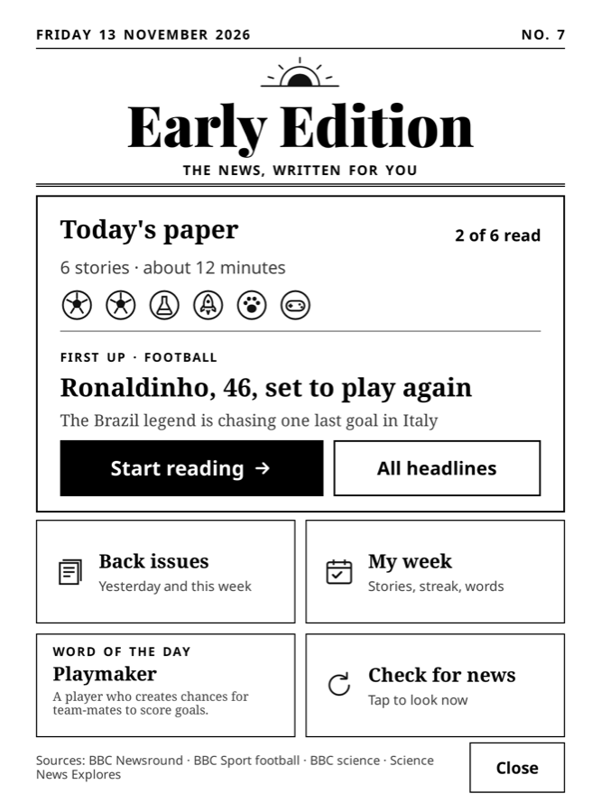 | 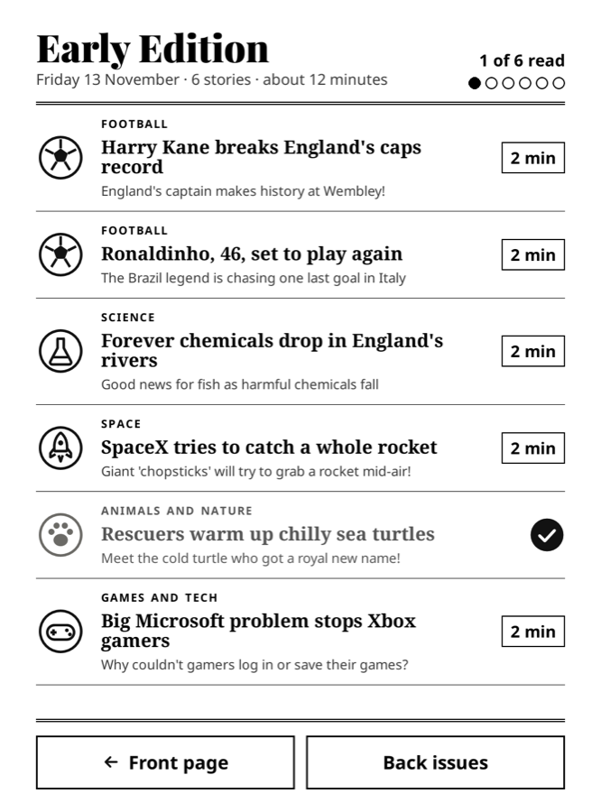 | 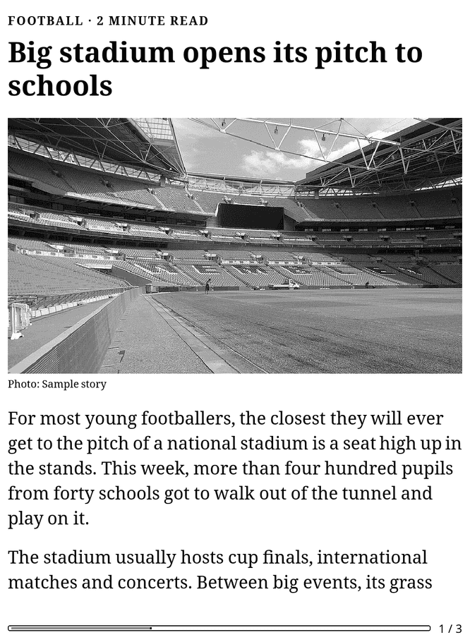 | 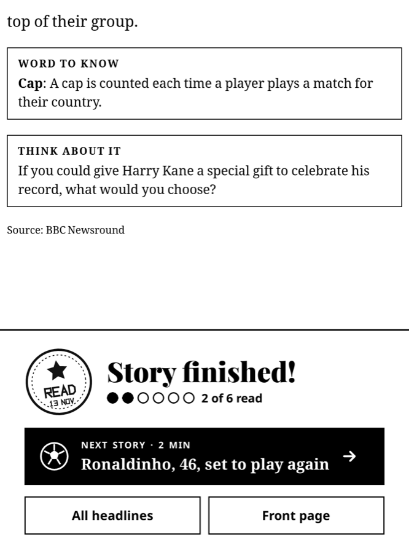 | 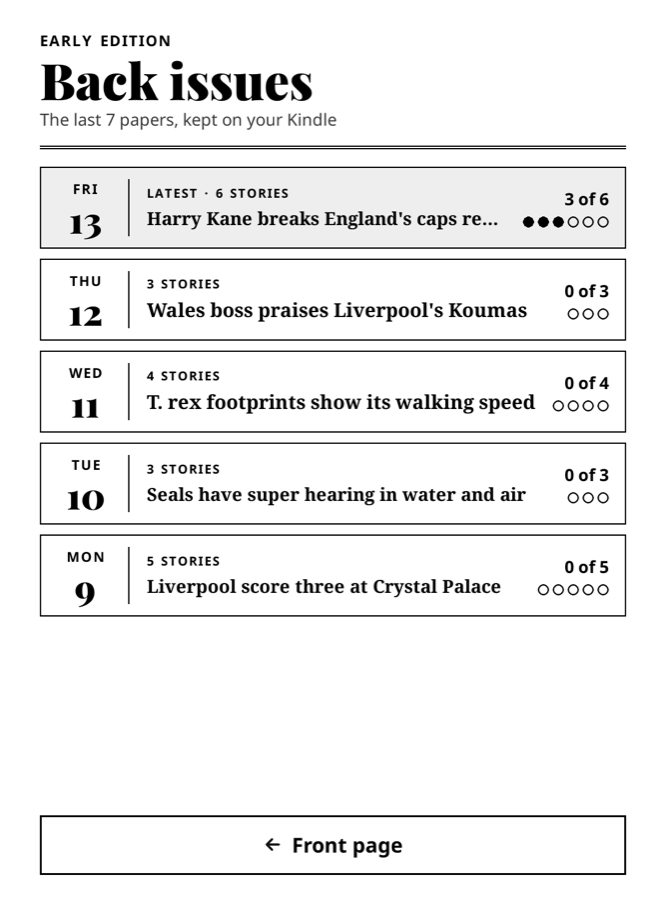 |

## Front page

- **Masthead:** the date, the issue number and the title.
- **Today's paper:** how many stories and minutes, how many are read, a topic icon per story, and the first unread story with **Start reading**. When that story has a photo, it sits beside the headline instead of the teaser, and tapping either opens the story.
- **Back issues** and **My week** open their own screens.
- **Word of the day** comes from one of today's stories.
- **Check for news** syncs straight away, ignoring the usual wait between automatic tries.

## Today's paper

- One large row per story: topic, headline, a one-line teaser and the reading time.
- A finished story turns grey and gets a tick. The dots at the top right fill in as the reader goes.
- Rows are tall on purpose, for a child's finger.

## A story

- Stories open in KOReader's normal reader: swipe or tap to turn the page.
- **Leaving early:** turning back from the first page (a left tap or a swipe right) closes the story and goes back to the headlines or front page it was opened from. What was read still counts; the story isn't marked read.
- **The photo:** most stories have the source's main photo under the headline, in grey and cropped to the page's width, with a credit. A story without one starts with its text. The photo makes a story about a page longer.
- The photo and the page are downloaded together, so a story never shows a missing picture.

## End of a story

- Every story ends with a **Word to know**, a **Think about it** question and the source.
- The **Story finished!** panel appears on turning forward from the last page, so it never covers unread text.
- **Next story** names the next unread story and opens it in one tap.

## Back issues

- The last 7 papers are kept on the Kindle, so this screen needs no network.
- Each row shows the day, the lead headline and how much of that paper was read.

## Sport

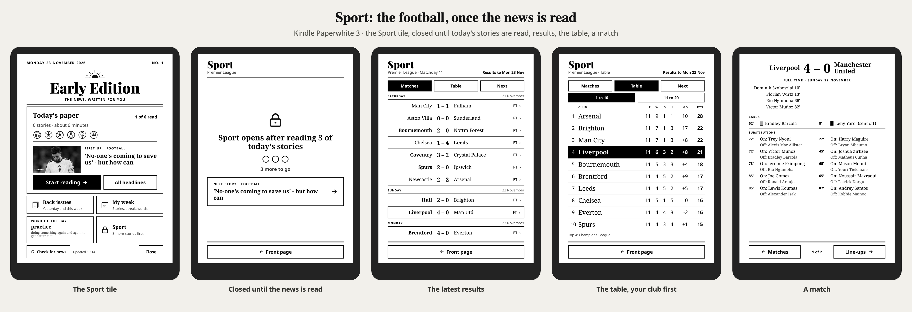

When the [Sport page](sports-page.md) is on for a child, Sport is one of the front page's tiles, in place of Check for news, which moves to the bottom row beside Close. It never shows a score.

| Front page | Matches | Table | A match | Line-ups | Closed |
|:---:|:---:|:---:|:---:|:---:|:---:|
| 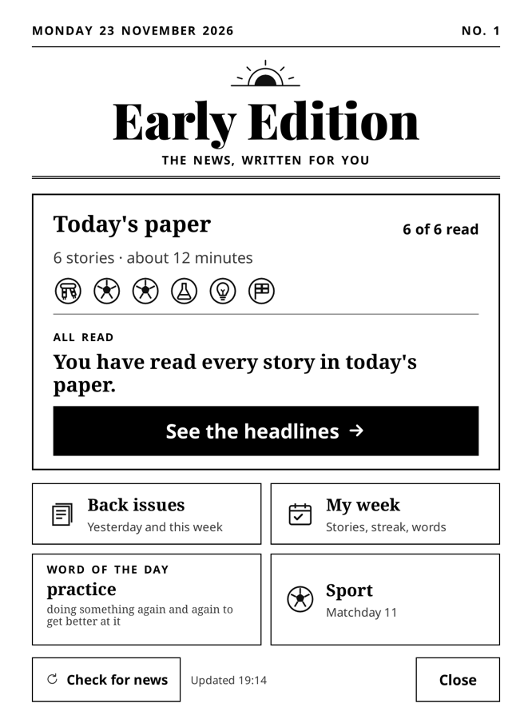 | 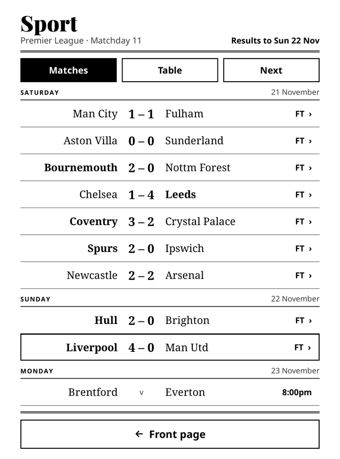 | 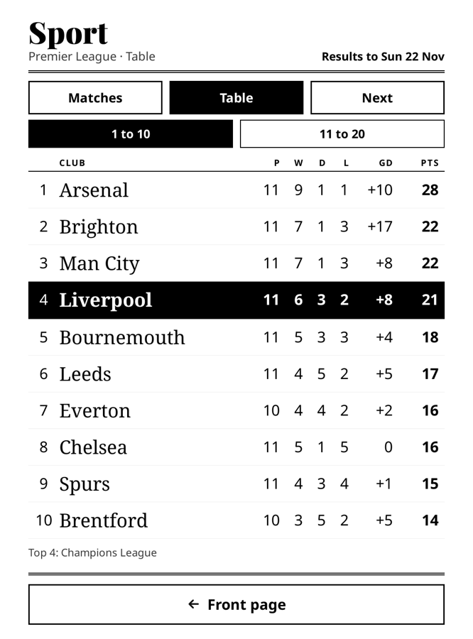 | 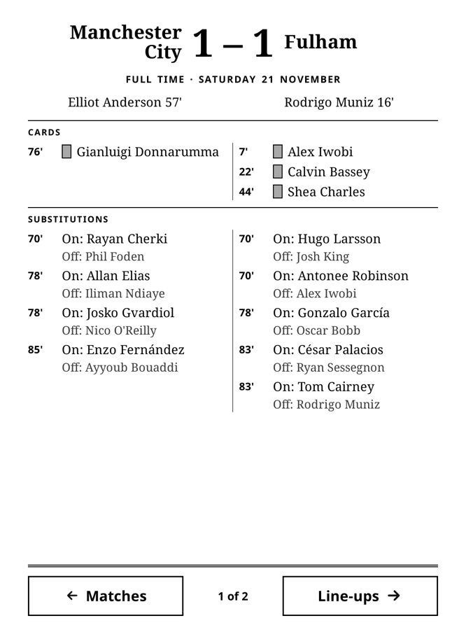 | 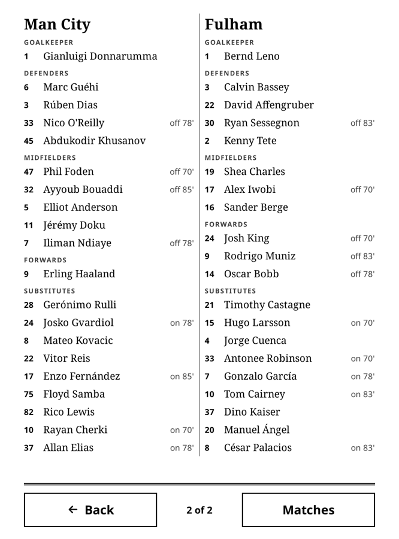 | 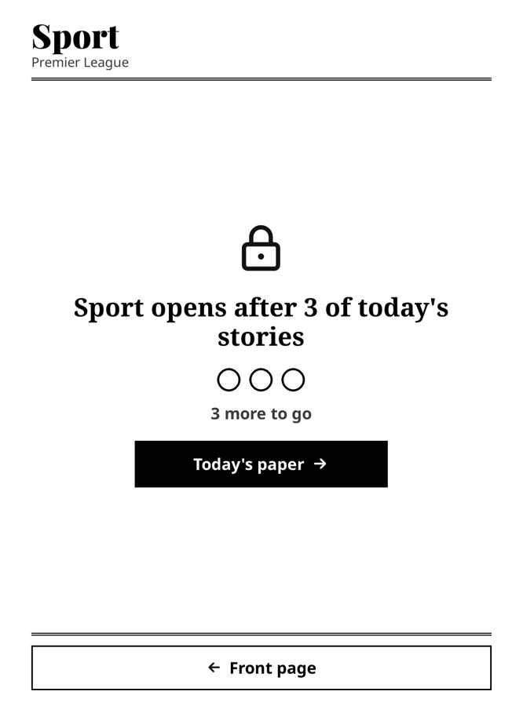 |

- **Closed first.** Until enough of today's stories have been read properly, the tile has a padlock and says how many more stories first, and tapping it shows the closed screen: the padlock, a dot for each story needed, and the headline of the next story that would count (an unread one first, then one read too quickly), which opens it. A story paged through too quickly doesn't count; if every story is read but not enough count, the tile says how many to read again. Reading on the iPad counts too, once the Kindle has synced.
- **Matches:** the latest matchday by day on one screen; his club's match is outlined and its winners in bold. A result with `›` opens.
- **Table:** ten clubs a page, his club's half first, his club in white on black. Tap `1 to 10` and `11 to 20`, or swipe.
- **Next:** the next round's fixtures with kick-off times.
- **A match:** two screens. The score, goals, cards, substitutions and injuries, then both line-ups side by side.
- It is the page fetched with the morning paper, kept on the Kindle, so it opens without Wi-Fi.

## With Simple UI

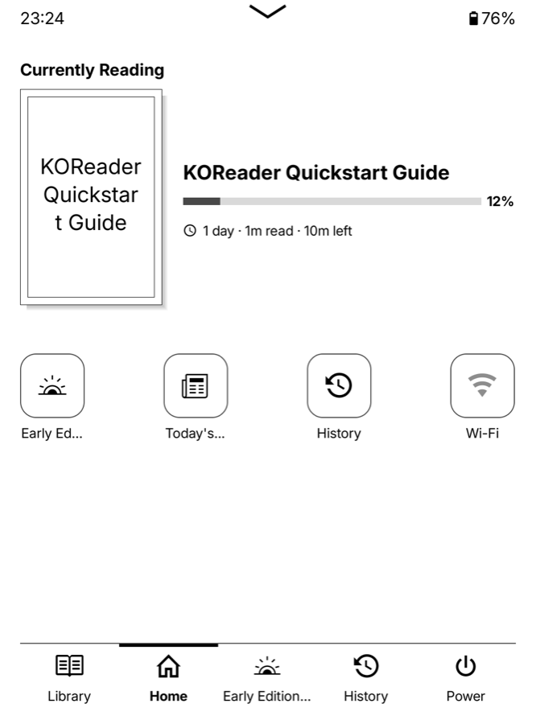

If the [Simple UI](https://github.com/doctorhetfield-cmd/simpleui.koplugin) plugin is installed, Early Edition fits into it rather than taking over: it can sit in Simple UI's navigation bar, as here, or as Quick Action buttons on its home screen for the front page and today's paper. The [plugin README](../plugin/README.md#using-with-simple-ui) explains how to place them.

## Where it started

The design began as three mockups, made before any code. The name then was "Morning News".

| Headlines | Reading a story | End of a story |
|:---:|:---:|:---:|
| 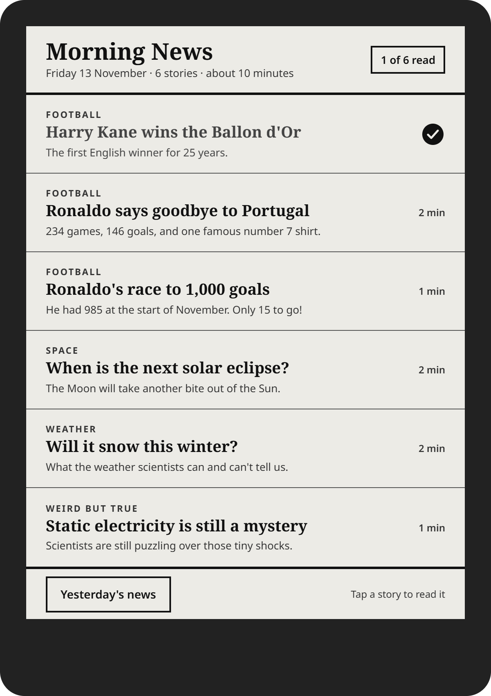 | 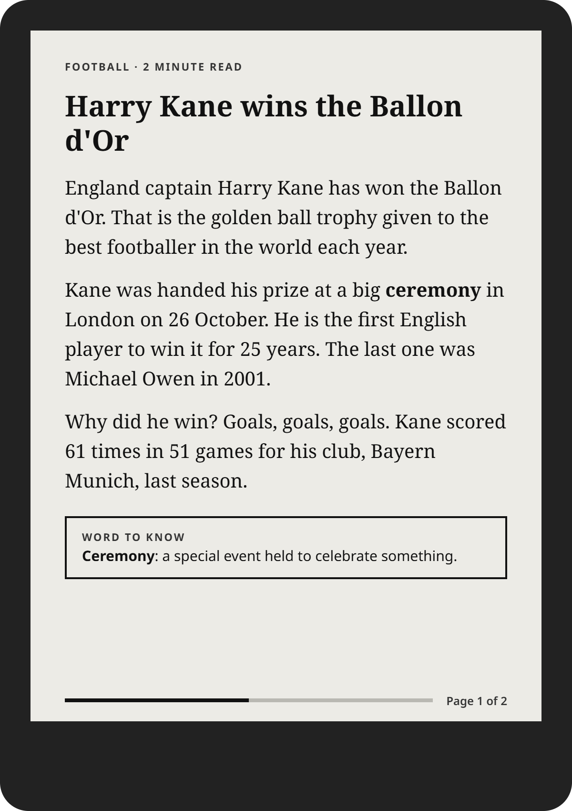 | 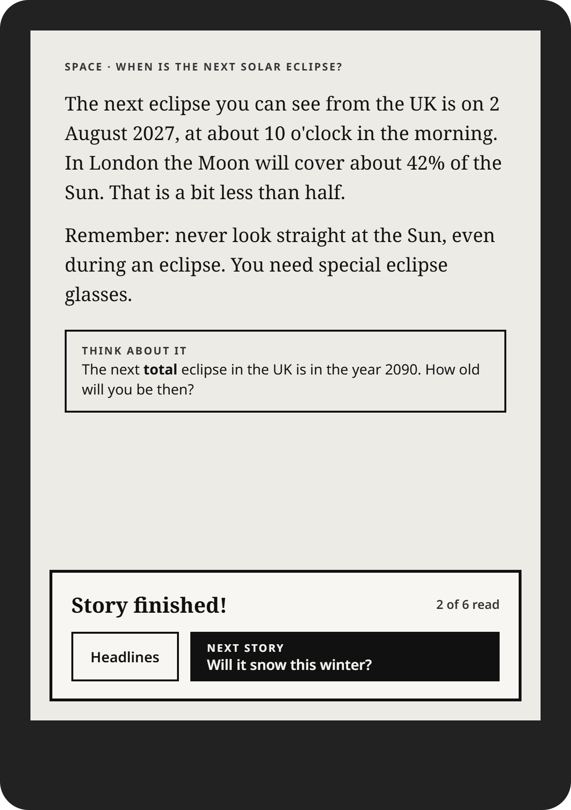 |

[DESIGN.md, section 11](DESIGN.md#11-mockups) lists where the build was expected to differ from them.

## Photo credits

The sample story is made up. Its photo is [Pitch side view, Wembley Stadium](https://commons.wikimedia.org/wiki/File:Pitch_side_view_-_Wembley_Stadium_-_geograph.org.uk_-_4624558.jpg) by Paul Gillett, [CC BY-SA 2.0](https://creativecommons.org/licenses/by-sa/2.0), from Wikimedia Commons.
