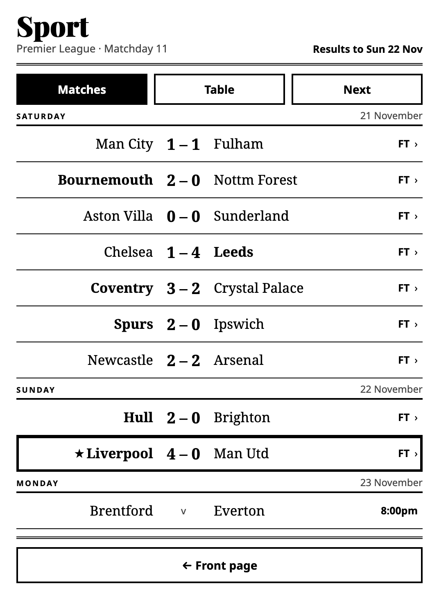
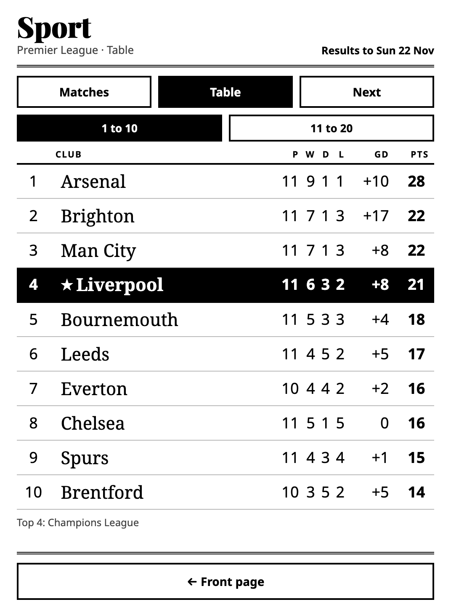
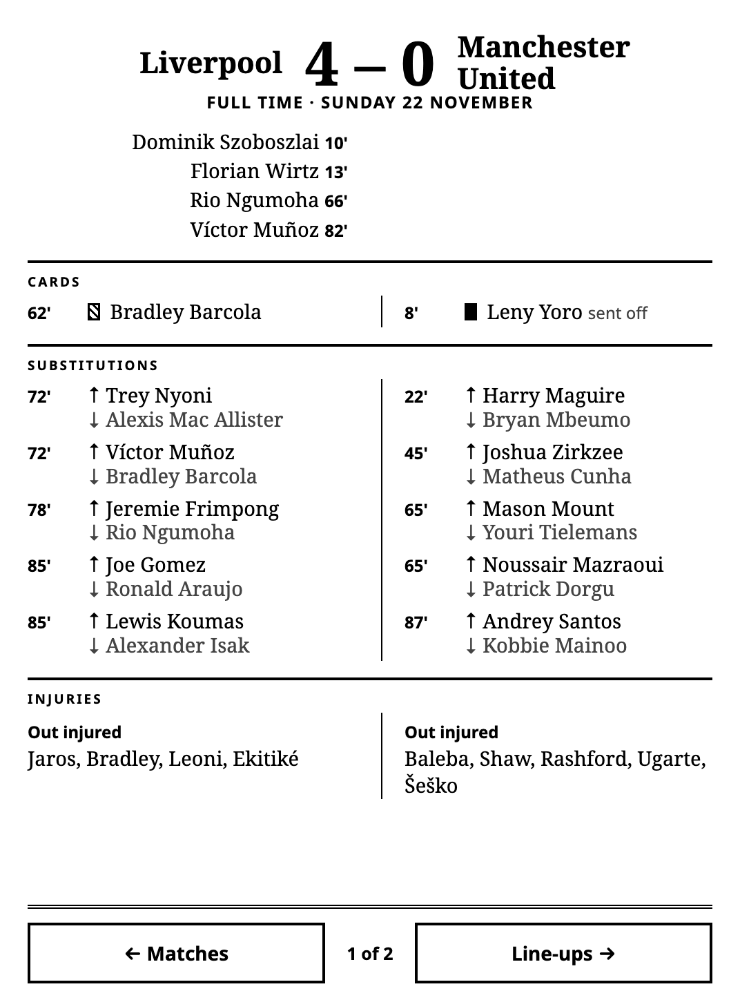
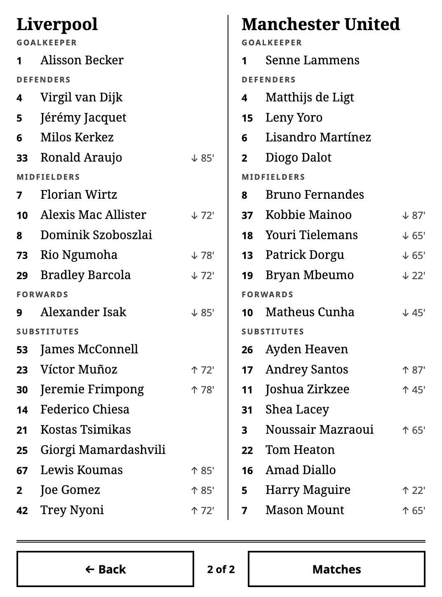
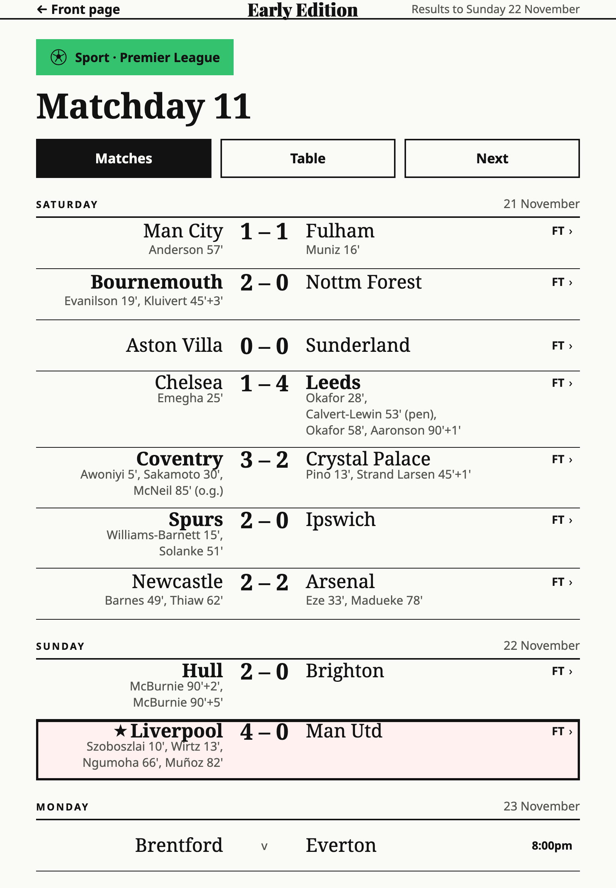
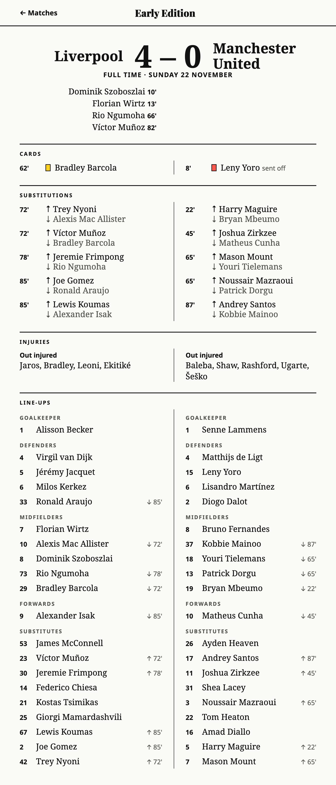

# The Sport page: spec and design

A proposal, being built. It adds one page to the paper: the Premier League table, the latest matchday's results, and the next matchday's fixtures. Tapping a result shows that match's line-ups, goals, penalties, cards, injuries and substitutions, and nothing else. The server fetches it once a day, with the morning paper, so it is always up to date as of the previous day's matches. The parent dashboard records which Sport pages were looked at and for how long.

Mockups: [`mockups/sports-page/index.html`](mockups/sports-page/index.html) (open it in a browser). They are drawn from the real matchday of 21 to 23 November 2026, as the server would have fetched it on the morning of Monday 23 November.

| Kindle: matches | Kindle: table, 1 to 10 | Kindle: a match | Kindle: line-ups |
|:---:|:---:|:---:|:---:|
|  |  |  |  |

| iPad: matches | iPad: a match |
|:---:|:---:|
|  |  |

## 1. What it is for

The reader follows football. The Sport page is the back page of a newspaper: yesterday's scores, the table and the next fixtures, with no writing to do.

It has to fit the paper's rules ([PRODUCT.md](../PRODUCT.md)):

- **It ends.** One table, one matchday, the next fixtures. No older rounds, no other competitions, no news, no video.
- **It is a newspaper, not a scoreboard.** It is made once a day with the paper and doesn't change during the day. There is nothing to keep checking.
- **Nothing leads out.** No links, no club sites, no crests fetched from anywhere. Everything comes from the home server.
- **Nothing unchecked is written.** The page is numbers, names and a fixed set of labels. No sentence from a data provider ever reaches the child (section 6), so there is nothing for the checker to check.
- **No AI.** The page costs no tokens.
- **It isn't a story.** It never counts toward "N of 6 read", the streak, reading minutes or topic weights. Time on it is recorded separately (section 5.4).

## 2. What the child sees

The page has three parts. In `pages` mode on the iPad and always on the Kindle they are three screens with tabs at the top (**Matches**, **Table**, **Next**); in `scroll` mode on the iPad they run down one page in that order.

### 2.1 Matches: the latest matchday

- **Which matchday.** The round whose first match kicked off most recently before the morning fetch. It stays until the next round has started, so on a Tuesday the page still shows the weekend. Rounds are the league's own numbered rounds, so a midweek round works the same way and a rearranged match appears with the round it belongs to.
- **Grouped by day**, in London time: Friday, Saturday, Sunday, Monday, each with its date. A day with no match isn't shown.
- **One row per match:** home team, score, away team, and a state on the right.

| State | Row shows | Tap |
|---|---|---|
| Played | the score and `FT` | opens the match |
| Not played yet (later today or later in the round) | `v` and the kick-off time, such as `8:00pm` | nothing |
| Postponed or abandoned | `Postponed` or `Abandoned`, no score | nothing |

- So on a Saturday morning the Friday night match has its score and the Saturday matches show their kick-off times; on Sunday morning Saturday's results are in.
- **His team's match** (config `favourite_team`) has a heavier outline and the team's name in bold with a small star. It is not moved out of time order. Nothing is said by colour alone.
- **Goalscorers under the score** on the iPad (surname and minute, as a newspaper prints them); the Kindle rows show the score only, to keep ten rows on one screen.
- **How fresh it is.** A line in the heading says which day the results go up to: `Results to Sunday 22 November`.

### 2.2 Table

- Position, club, played, won, drawn, lost, goal difference, points, as it stood at the morning fetch.
- **On the iPad** all 20 clubs are on one screen. **On the Kindle** the table is two pages, places 1 to 10 and 11 to 20, because 20 rows on one screen would put club names at about 7 pt. With ten rows they are about 10 pt. Two buttons under the tabs (`1 to 10`, `11 to 20`) switch pages, as does a swipe, and the table opens on the page with his team.
- His team's row is inverted (white on black) on the Kindle and tinted with the team colour on the iPad, with the star.
- Two thin rules mark the Champions League places and the relegation places, each explained in a line under the table (`Top 4: Champions League`, `Bottom 3: relegation`). On the Kindle each page shows the rule and the line that belong to it. The provider says which places these are, so a fifth Champions League place appears if the league has one.

### 2.3 Next: the next matchday's fixtures

- Grouped by day like Matches, each row: home team, `v`, away team, kick-off time in London time.
- His team's fixture is marked the same way.
- Nothing to tap. No predictions, no odds, no TV channels.

### 2.4 A match

Opened by tapping a played match. It is one page that scrolls on the iPad and two screens on the Kindle (what happened, then the line-ups). It shows exactly these, in this order, and a part with nothing in it is left out:

1. **Score.** Both teams, the score, `FULL TIME` and the day.
2. **Goals.** Under each team: scorer and minute. A penalty is marked `(pen)`, an own goal `(o.g.)` and listed under the team it counted for.
3. **Penalties.** Any penalty not scored: taker, minute, and `missed` or `saved`. Scored penalties are already in Goals.
4. **Cards.** Yellow and red, with player and minute, by team. A second yellow shows as yellow then red at the same minute. The card is a small upright rectangle, hatched for yellow and solid for red on the Kindle.
5. **Substitutions.** By team, in order: minute, the player coming on, the player going off.
6. **Injuries.** Two short lists per team: **Went off injured** (players substituted because of an injury in this match, with the minute) and **Out injured** (players listed as injured on the morning of the match who were not in the squad). Names only, with no description of the injury.
7. **Line-ups.** The two teams side by side: each starting eleven with shirt numbers, grouped as Goalkeeper, Defenders, Midfielders, Forwards, then the substitutes' bench. A starter who went off has `↓ 72'` after his name; a substitute who came on has `↑ 72'`.

**And nothing else.** Not shown, even though the feeds have them: assists, possession, shots, expected goals, player ratings, commentary, the referee, the stadium, attendance, form guides, head-to-head records, odds and predictions, suspensions, transfer news, photos and video.

### 2.5 Getting there

- **Front page.** One full-width strip under Today's paper, on both devices: `Sport`, `Premier League · Matchday 11`, and on the right `Table, results, fixtures →`. It never shows a score, so a child waiting to watch the highlights isn't told the result by the front page.
- **From Sport,** a **Front page** button goes back, as on the other screens.
- There is no route to Sport from inside a story and no "next" from Sport into a story. It sits beside the paper, like Back issues and My week.

### 2.6 When there is nothing to show

| Situation | The page says |
|---|---|
| Sport is turned off for this profile | no strip on the front page; the page doesn't exist |
| The server has never managed to fetch scores | no strip on the front page |
| The device can't reach the server | the last page it loaded |
| Between seasons (no round has started) | the Next part only, headed with the opening day; Matches and Table are left out |
| The season has ended | the final table and the last matchday, `Final table` |

## 3. Updates: once a day

The page changes once a day, like the paper.

- **The server** fetches everything at the start of the morning run (`POST /admin/generate`, or `GENERATE_AT`), before any paper is made, and on start if it has nothing from today. One fetch serves every profile. It never runs in response to a device asking. A failed fetch doesn't stop the paper: the run carries on and the page keeps yesterday's data (section 7).
- **`POST /admin/sports`** (with `X-Admin-Token`) runs the fetch again by hand, for testing or after a failure.
- **The devices** fetch the Sport page with the paper: the Kindle in its sync, after the issue; the iPad when it loads today's paper. Both keep the last one, so Sport opens without the server. There is no polling, no refresh button and no notification.

A fetch is about ten requests: the rounds and fixtures, the injury list, the table, one scoreboard per match day of the latest round so far, and one summary per newly played match. A summary is fetched once and kept.

## 4. Where the data comes from

Checked from the owner's network on 23 November 2026, and decided the same day. Both feeds are free, need no key and no account, and are undocumented: they are the JSON behind ESPN's and the Fantasy Premier League's own sites.

| Need | Source | Verified |
|---|---|---|
| Scores and state | ESPN `site.api.espn.com/apis/site/v2/sports/soccer/eng.1/scoreboard?dates=YYYYMMDD` | yes: ten matches of round 11 |
| Line-ups, substitutions, goals, penalties, cards | ESPN `.../eng.1/summary?event=<id>` (`rosters`, `keyEvents`) | yes: both elevens with positions, bench, who replaced whom and when |
| Went off injured | the same `keyEvents`: a substitution whose text ends "because of an injury" | yes: three in round 11 |
| Table | ESPN `site.api.espn.com/apis/v2/sports/soccer/eng.1/standings` | yes: 20 rows with the Champions League and relegation places marked |
| Rounds (which matches make a matchday), next fixtures | Fantasy Premier League `fantasy.premierleague.com/api/bootstrap-static/` (`events`, `teams`) and `/api/fixtures/` | yes: round 11 current, round 12 next with kick-off times |
| Out injured | the same `bootstrap-static` (`elements` with `status: "i"`) | yes: 66 players marked injured |

Things the build must know about these feeds:

- **ESPN has no round number.** Rounds come from the Fantasy feed. A club is at home to each other club once a season, so an ESPN match is joined to its Fantasy fixture by the home and away clubs. Clubs are matched between the feeds by name through a small alias table in the code ("Nott'm Forest", "Nottingham Forest"); a club it can't match is logged and its matches still show, without injuries.
- **The scorer is the first participant** of an ESPN goal event; the second is the assist, which is not shown. The per-player `plays` list marks the assister as a scorer too, so goals are read from `keyEvents`, not from the roster.
- **The summary also carries odds, betting picks, commentary, news and video.** The adapter reads `rosters` and `keyEvents` and nothing else. Gambling is on the paper's skip list.
- **ESPN refuses a date range** on the scoreboard for this league (400); ask a day at a time.
- **They are unofficial.** Either could change or stop without notice. Section 7 says what the page does then. The adapters sit behind one interface so a paid feed can replace them without touching the page: API-Football (about $19 a month) and football-data.org with its deep-data plan (about €29 a month) both carry the same things. Their prices are from third-party pages and should be checked before choosing one.
- **Requests say nothing about the household.** The server asks for the whole league, never for one club, and sends a generic client name.
- **"Out injured" is a morning snapshot.** The injury list is taken each morning for every match of the latest and next rounds that hasn't kicked off; once a match has been played its list is kept and players who were in its squad are taken off it.

## 5. Server

### 5.1 Config

```yaml
sports:
  enabled: true     # per profile; off when the key is missing
```

A profile may set `sports` like any other key. The page uses the existing `favourite_team` to mark his club; it matches a club's full or short name without regard to case, and no match is a warning in the log, not an error.

### 5.2 Storage

One file for the server, not per profile: `$DATA/sports/premier-league.json`, written whole and renamed into place, holding the last good state: rounds, the latest and next rounds' matches with their details and injury snapshots, the table, and the fetch times. It is read at start so a restart serves the last page at once. No history is kept: when a new round becomes the latest, the old one's details are dropped. No database table and no migration.

### 5.3 API

On the Kindle port, under every mount like the other reader routes.

**`GET <mount>/api/sports`** returns 404 when Sport is off for the profile or nothing has been fetched yet, else:

```ts
type SportsView = {
  competition: "Premier League";
  updated_at: string;                 // when the data was fetched, UTC ISO
  results_to: string | null;          // London date of the latest played match in `matchday`
  favourite_team: string | null;      // a Team id
  teams: Team[];
  matchday: Matchday | null;          // the latest round; null between seasons
  next: Matchday | null;              // the round after it; its matches carry no detail
  table: { final: boolean; rows: TableRow[]; lines: { after: number; label: string }[] } | null;
};
type Team = { id: string; name: string; short: string };           // "Manchester City", "Man City"
type Matchday = { number: number; days: { date: string; matches: Match[] }[] };   // London dates, oldest first
type Match = {
  id: string; kickoff: string;                                       // UTC ISO
  home: string; away: string;                                        // Team ids
  state: "scheduled" | "finished" | "postponed" | "abandoned";
  score: { home: number; away: number } | null;                      // only when finished
  goals: Goal[];                                                     // for the scorers under a result; [] until finished
  detail: MatchDetail | null;                                        // only when finished and its summary was fetched
};
type Side = "home" | "away";
type Goal = { side: Side; player: string; minute: string; kind: "goal" | "penalty" | "own_goal" };
type Player = { name: string; number: string | null; on: string | null; off: string | null };   // minutes, "72'"
type MatchDetail = {
  goals: Goal[];
  penalties: { side: Side; player: string; minute: string; outcome: "missed" | "saved" }[];
  cards: { side: Side; player: string; minute: string; card: "yellow" | "red" }[];
  lineups: Record<Side, {
    starting: { line: "goalkeeper" | "defenders" | "midfielders" | "forwards"; players: Player[] }[];
    bench: Player[];
  }>;
  subs: { side: Side; minute: string; on: string; off: string; injury: boolean }[];
  out_injured: Record<Side, string[]>;
};
type TableRow = { position: number; team: string; played: number; won: number; drawn: number;
                  lost: number; goal_difference: number; points: number };
```

- `side` on a goal is the team it counted for. `subs[].injury` is the "went off injured" mark.
- `lines[].after` is the position after which a rule is drawn: `{after: 4, label: "Champions League"}` and `{after: 17, label: "Relegation"}`.
- The issue payload gains `"sports": {"path": "/api/sports", "label": "Premier League", "matchday": 11} | null`, null when the page would 404. This is how both readers learn the page exists and what to print on the front page strip; older clients ignore it.

### 5.4 What the dashboard sees

The dashboard records which Sport pages were looked at and for how long, as it does for stories, but kept apart from reading.

- **Event.** A new type, `sport_viewed` (`story_id` null), sent when the child leaves a Sport page: for another tab, back to the front page, into a match or out of one, or when the device sleeps or the app is hidden. Payload `{page, match_id, matchday, active_seconds}`:
  - `page` is `"matches"`, `"table"`, `"next"` or `"match"`; the Kindle table's two halves are both `"table"`, and a match's two Kindle screens are one `"match"` view.
  - `match_id` is the match's `id` for `"match"`, else null. `matchday` is the round shown.
  - `active_seconds` follows the stories' rules: paused while asleep or hidden, and at most 300 seconds between interactions. A page left within 2 seconds is not sent, so flicking through tabs doesn't count.
- **Stored** like other events. When it arrives the server adds `match` to the stored payload, a label made from its own data such as `"Liverpool 4–0 Man Utd"`, so the dashboard still reads correctly after that round has gone from the Sport data. An unknown `match_id` keeps a null label.
- **Never reading.** `sport_viewed` events don't count toward read stories, reading days, the streak, reading minutes, share cards or topic weights.
- **Dashboard API** (per profile, under `/api/dashboard`):

```ts
type SportPageUse = { page: "matches" | "table" | "next" | "match";
                      match_id: string | null; match: string | null;   // the label, for "match"
                      views: number; seconds: number };
type SportDay = { date: string; views: number; seconds: number;
                  pages: SportPageUse[] };          // that day's totals per page, and per match, most time first
type SportUsageView = { from: string; to: string;
                        days: SportDay[];          // oldest first, one per date, gaps filled with zeros
                        views: number; seconds: number;
                        pages: SportPageUse[] };   // the range's totals, most time first
```

| Method and path | Returns |
|---|---|
| `GET /sport?days=14` | `SportUsageView` for the last `days` days (7 to 120) ending today |
| `GET /day/YYYY-MM-DD` | `DayView` gains `sport: SportDay \| null` (null with no Sport views that day) |

  A day is the London date of the event's `ts`, as for reading.
- **On the dashboard** (the `web/` part, later): the Day screen shows a Sport line, such as "Sport · 6 min: Table 3 min, Liverpool 4–0 Man Utd 2 min, Matches 1 min"; the Reading page gets a Sport panel with minutes a day and the most-viewed pages. The Server page shows the last fetch and its error, if any (from `GET /api/dashboard/about`, which gains `sport: {updated_at, error} | null`).

## 6. Safety

The page bypasses the writer and the checker, so it is built so that it can't say anything.

- **Fixed vocabulary.** Every word on the page except a name is ours: the labels in section 2. Provider text (event descriptions, injury notes, commentary, headlines) is used only to set a flag and is then discarded. An injury is a name on a list; the feed's "Concussion" or "Illness" never appears.
- **Names are cleaned.** Player names are plain text, capped at 40 characters, with tags and control characters stripped. Club names come from the code's own table of clubs, with the provider's name only for a club the table doesn't know.
- **Validated before it is kept.** Each provider response is parsed against a schema (zod, like `schemas.ts`); a response that doesn't fit is dropped and the last good state stays. Scores must be whole numbers from 0 to 20, minutes must look like minutes, a round must have between 1 and 10 matches.
- **Left out on purpose:** suspensions and anything about why a player is missing other than injury, anything about betting, and all free text.
- **The blocklist** in the config applies to player names too: an entry whose name contains a blocked word is left out. It is unlikely to matter and costs nothing.

## 7. When the feeds fail

- **A fetch fails or doesn't validate:** keep the last good state, log one line, and record the error for the dashboard's Server page. The next morning's run tries again; `POST /admin/sports` tries at once. Each part (rounds, table, scores, a match's summary) is kept or dropped on its own, so one broken response doesn't lose the rest.
- **A feed changes shape for good:** the page shows the last good state for 3 days, then the API answers 404 and the front page strip goes away. The paper is not affected in any way.
- **A match's summary can't be fetched:** it shows its score and scorers and can't be opened. It is tried again at the next fetch.
- **The two feeds disagree** about a kick-off time or a postponement: ESPN wins for anything about a match that has been played, the Fantasy feed for which round it is in.

## 8. Design

The page is the paper's, in the paper's faces and rules: Playfair Display for the page title, Noto Serif for club names and scores, Noto Sans for labels, times and table figures, 2 px ink rules, square corners. Figures are tabular so the table's columns line up.

- **Kindle** (1072 × 1448, grey, touch): match rows 88 px tall, close to the 90 px of Today's paper, so that ten matches and their day headings fit one screen without scrolling; the table is two pages of ten rows at 82 px a row, with club names at 42 px (about 10 pt). Tabs are three boxed buttons under the heading, the current one inverted.
- **iPad:** the same layout with the paper's colours. Sport takes the Football topic green (`--football`) for its flag; his team's row takes the team red (`--team`) as a tint behind dark ink. The three page colours (paper, sepia, night) apply. Type follows the age band but the table has a floor so 20 rows still fit a portrait screen for the youngest band.
- **A match:** the score is the headline. Goals sit directly under it in two columns, home left and away right, so the story of the match reads top to bottom before any list starts. Line-ups are two columns side by side on both devices; on the Kindle they have a screen to themselves.
- **Club names:** short names everywhere a row is tight ("Man City", "Nottm Forest", "Spurs"), full names on a match's own page. No crests and no kit colours in v1: they would need images from outside or a table of colours to maintain.

## 9. Changes by part

| Part | Change |
|---|---|
| `server/` | `src/sports/` with the ESPN and Fantasy adapters, the daily fetch and the state file; the `sports` config key; `GET /api/sports` on each mount; `sports` in the issue payload; `POST /admin/sports`; the `sport_viewed` event type and its match label; `GET /api/dashboard/sport`, `sport` in `DayView` and in `AboutView`; recorded responses from both feeds under `tests/fixtures/sports/` |
| `reader/` | the front page strip; a Sport view (three pages or one scroll) and a match view; `sport_viewed` events; the payload kept in `localStorage` under the mount's namespace |
| `plugin/` | the front page strip; `ui/sport.lua` and `ui/match.lua` built from the existing row, header and button widgets; fetch in the sync; `sport_viewed` events; the payload kept in the settings directory |
| `web/` | the Sport line on the Day screen, a Sport panel on the Reading page, the last fetch on the Server page |
| `docs/` | CONTRACT.md gains the shapes above; settings.md the config key; kindle.md and ipad.md a section each |

Order: the server first (it can be judged with `curl`), then the iPad, then the Kindle, then the dashboard.

## 10. Testing

- **Adapters:** recorded responses from both feeds for played, unplayed and postponed matches, and for a match with a penalty scored, a penalty missed, an own goal, a red card and an injury substitution. Round 11 (21 to 23 November 2026) has most of these.
- **Rules:** which round is "latest" at each point of a week, including a midweek round and the gap between seasons; grouping by London day across the clock change; the morning injury snapshot.
- **Safety:** a response with markup in a name, an absurd score and an unknown club is dropped or cleaned as section 6 says; no provider sentence appears anywhere in the payload (a test that searches the output for words from the fixtures' commentary).
- **Usage:** `sport_viewed` events add up per day and per page in the dashboard API and leave every reading figure unchanged.
- **Readers:** the views against fixture payloads at every age band and page colour; ten matches on one Kindle screen and ten table rows a page in the emulator, and the table's type judged on the device itself.

## 11. Decisions

| Decision | Chosen |
|---|---|
| Data source | The two free, unofficial feeds, behind one interface; a paid feed if they stop working. Decided 23 November 2026. |
| How often it updates | Once a day, with the morning paper. Decided 23 November 2026. |
| Tracking | Which Sport pages were looked at and for how long, on the dashboard, apart from reading. Decided 23 November 2026. |
| Kindle table | Two pages of ten. Decided 23 November 2026. |
| Scores on the front page | Never: the strip says only that Sport is there (default; the alternative is his team's latest score on the strip) |
| Who was "out injured" | Players listed as injured on the morning of the match (default; the alternative is "went off injured" only, which needs one feed fewer) |
| Other competitions (England, Champions League, FA Cup) | Not in v1 (default) |
| Sport on school mornings | Always available (default; the alternative is hiding the strip until a set time on weekdays) |

## 12. Out of scope for v1

Live scores, other competitions and the women's game, older matchdays, a club's own page, player pages, top scorers, form, a pitch drawing of the formation, crests and kit colours, commentary, notifications, and a dashboard switch for turning Sport on.
